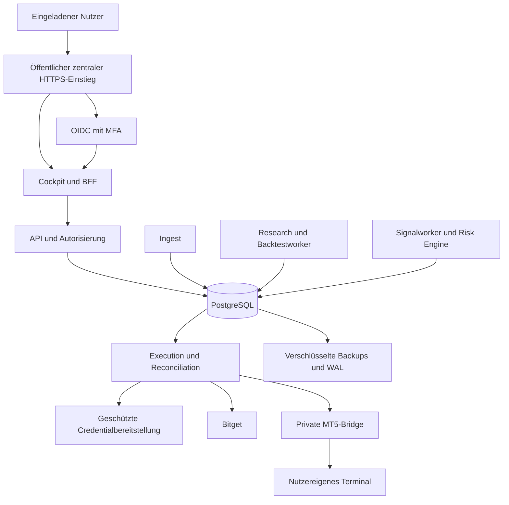
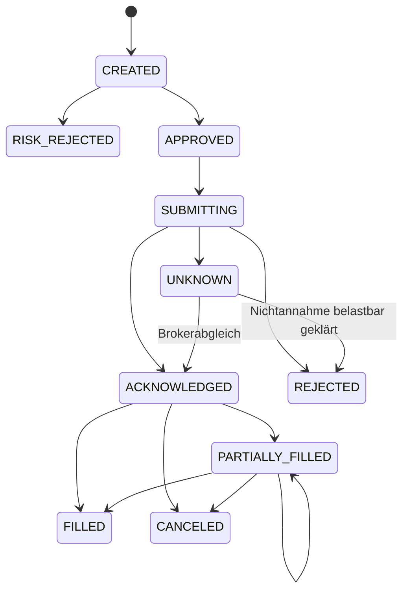

# Architektur und Stack

Stand 2026-11-07. Q7 bestätigt den Grundstack aus Python/FastAPI,
Next.js/TypeScript, PostgreSQL und getrennten Workern im modularen Monolithen.
Q13/Q14 bestätigen Docker Compose und lokales Authelia.
Q31 bestätigt den Umsetzungsstart. Cockpit, API, PostgreSQL und Authelia laufen
lokal über Compose; Crypto-Kern, RLS, immutable Snapshots und ein tenantgebundener
Offline-Researchworker mit gespeicherten Ergebnissen sind implementiert.
Konkrete Pins: [runtime-pins.md](runtime-pins.md). Noch nicht implementierte
Execution-/Broker-/Betriebskomponenten bleiben Zielarchitektur. CI/CD ist offen.
Begründungen und offizielle Belege: [sources.md](sources.md).

Die ausdrücklich freigegebene Entwicklungsvorschau verwendet jetzt zentralen
öffentlichen Caddy80/443 mit Let’s Encrypt. Default-Compose bleibt lokal;
interne Dienste erhalten keine Hostports. Öffentlicher Issuer, vorhandener
Entwicklungstenant und eigene Passkey-RP: [https-entry.md](https-entry.md).

Der interne Aktionsnachweis007 liegt dauerhaft in PostgreSQL und verbindet
den vorhandenen WebAuthn-Verifier mit Challengeclaim, Faktor-CAS und
Vorschau-Bestätigung. Er ersetzt keinen IdP-Claim und öffnet keine Brokerroute:
[Passkey-Aktionsnachweis](passkey-action-proofs.md).

## Systemgrenzen

Bestätigt: modularer Monolith für API und Domäne, getrennte Prozesse für
zeitkritische Execution und ressourcenintensive Forschung. Keine anfängliche
Microservice-Infrastruktur; fachliche Verträge erlauben spätere Trennung.

Der fachliche Kern importiert weder FastAPI noch Broker-SDKs. API, Worker,
Simulator und Brokeradapter rufen denselben versionierten Strategievertrag auf.

## Technologieauswahl

API/Cockpit/Trading/PostgreSQL/persistente PostgreSQL-Jobs sind grundsätzlich
bestätigt. Docker Compose und Authelia ebenfalls bestätigt;
konkrete Laufzeitpins und Anwendungslockdateien sind umgesetzt.
Q8 bestätigt eigene MFA-Anmeldung statt anfänglichem Website-SSO.

| Ebene | Vorschlag | Grund / Alternative |
|---|---|---|
| Cockpit | Next.js, React, TypeScript | Nähe zum Referenzstack; reines React-SPA wäre einfacher, wenn SSR keinen Nutzen hat |
| API | Python, FastAPI, Pydantic | Trading-/Researchökosystem und vorhandene Komponenten |
| Tradingkern | Typisiertes Python, dezimale Orderrechnung | Wiederverwendung; Performance gezielt messen statt verfrüht neu schreiben |
| Datenbank | PostgreSQL | Transaktionen, RLS, Outbox und PITR |
| Migrationen | Nummerierte SQLmigrationen mit Prüfsummen und eigenem Pythonrunner | Angewendete Dateien unveränderlich, separate Migrationsrolle |
| Jobs | PostgreSQL-Jobtabelle/Outbox mit Leasing | Wenige Dienste; Redis/RabbitMQ erst bei nachgewiesenem Bedarf |
| Historien | Begrenzte kanonische JSONsnapshots in PostgreSQL; Parquet später bei gemessener Größe | Retention und Lizenzen prüfen; TimescaleDB vorerst keine Pflicht |
| Charting | Eigenes SVG für begrenzte Equitykurven | Keine zusätzliche Bibliothek; umfangreichere Charts später bewerten |
| Auth | Lokales Authelia OIDC mit Passwort + TOTP/WebAuthn | Q14 bestätigt; administrierte Privatnutzer, SSO später |
| Secrets | Envelope Encryption, unabhängige Schlüsselverwaltung | Provider/KMS/Tresor und Budget noch offen |
| Deployment | Docker Engine + Compose | Q13 bestätigt; exakte Pins und Ressourcenprüfung vor Installation |
| Monitoring | Strukturierte Logs, fachliche Metriken und Healthchecks | Konkrete Werkzeuge nach Ressourcen-/Betriebsentscheidung |
| CI/CD | Noch offen | Neue Toolabhängigkeiten erst nach Nutzerfreigabe |

Der kleine Host spricht gegen einen gleichzeitig laufenden großen Identity-,
Monitoring- und Researchstack. Externe Dienste sind ebenso wenig stillschweigend
freigegeben wie zusätzliche lokale Dienste.

### Bestätigte Auswahl für den privaten Start

Q13 wählt Docker Compose ausdrücklich statt des systemd-Vorschlags.
Docker Engine/Compose ist auf Ubuntu 26.04 offiziell unterstützt.
Container brauchen getrennte Identitäten, Ressourcenlimits und einen zentralen
Einstieg. Containerisierung spart nicht automatisch Anwendungsspeicher.

Q14 bestätigt Authelia lokal als fertigen OIDC-Provider: administrierte
Privatnutzer, Passwort plus TOTP/WebAuthn und `two_factor`-Clientpolicy.
Keine öffentliche Selbstregistrierung. In-Memory-Sessions für einen einzelnen
Host und eigene PostgreSQL-Rolle/-DB sind mögliche kleine Konfigurationen.
Ein Neustart verliert IdP-Memorysessions, widerruft aber nicht automatisch
alle Cockpit-/BFF-Sessions oder bereits ausgegebenen Tokens.
Argon2 benötigt zusätzlichen Speicher je
parallelem Login. Herstellerwerte ersetzen keinen gemeinsamen Lasttest.

ZITADEL Cloud Free bleibt eine verworfene Startalternative mit MFA, aber externer
Identitätsverarbeitung, Quoten und kurzen Logs. Der eingebaute
SMTP-Weg ist für Test/Evaluation, deshalb muss produktiver Recovery-/Mailbetrieb
separat gelöst werden. Keinen Provideraccount einrichten, bevor die Variante
und Verarbeitung bestätigt sind.

Keycloak empfiehlt allein für einen kleinen produktionsfähigen Container
2 GB; authentik nennt mindestens 2 GB Host-RAM. Beide sind auf diesem gemeinsam
genutzten Host ohne zusätzliche Kapazität kein Ausgangsvorschlag.
Authelia-Passkey-Login wird nicht pauschal als allein ausreichende MFA gewertet:
die entsprechende Zwei-Faktor-Interpretation ist laut Docs experimentell.

### Versions- und Buildpolicy

Vor Codebootstrap: unterstützte Python-/Node-Versionen und Adapterkompatibilität
prüfen; Hostversionen sind Inventur, keine Laufzeitentscheidung.
Pakete erhalten exakte Versionspins plus committed Lockdateien/Hashes.
Container bekommen konkrete Version und Digest; keine `latest`, Major-only-Tags
oder `npm install || true`. JavaScript-Builds verwenden den Lockfile-Modus.

Der ausgewählte Stand wird mit Supportende, Quelle und Prüfdatum dokumentiert.
Updates gehen durch Änderungsprüfung und relevante Tests; Sicherheitsfixes
werden nicht durch unbegrenzt eingefrorene Pins verhindert.
Eine Softwarestückliste und Lizenzinventur sind spätere Abnahmeartefakte.

### Getrennte IdP-Datenbank und Runtimeausnahme

Authelia erhält eine eigene PostgreSQL-Datenbank/-Rolle ohne Zugriff auf
Tradingdaten. `PUBLIC`-/`CONNECT`-Rechte ebenfalls begrenzen.
Authelia migriert sein Schema beim Start: DDL ist dort ausschließlich innerhalb
der eigenen IdP-Datenbank erlaubt. Die Trading-Runtime bleibt ohne DDL.
Upgrade-/Restoreplanung muss diese Fremddienstausnahme berücksichtigen.

Compose-, TLS-, Session- und Recoverydetails: [deployment-plan.md](deployment-plan.md).
Q20 bestätigt öffentlichen HTTPS-Zugang schon im Privatpilot; interne Dienste
bleiben unveröffentlicht. Q21 bestätigt vorhandenen kostenlosen SMTP.
Q24 bestätigt administratives E-Mail-Recovery; Laufzeitnachweise stehen aus.

## Fachmodule und Datenmodell

Kontoänderungen erhalten einen bestätigten zusätzlichen Cockpit-Passkey:
Authelia-Reauth liefert keinen belastbaren Nachweis einer neuen Faktorverwendung.
SimpleWebAuthn14.1.0 prüft Registrierung und Assertions. Additive006 ergänzt
eine dauerhafte FORCE-RLS-Registry mit einem Faktor je Tenant/Nutzer/RP,
RP-weit eindeutiger Credential-ID einschließlich Widerruf, Ticket und Audit.
Lokales Browser-Enrollment bindet Einmalchallenge an Sitzung/CSRF/Identität/
Epoch/Origin; sein Ticketclaim wird vor der Kryptoprüfung committed.
Administrativer Widerruf erhöht die globale Nutzer-Auth-Epoch und setzt
`reauth_after`; Wiederherstellung bleibt offen. Counter-/Versions-CAS ist
eine vertrauenswürdige SQL-Primitive ohne eigenen Challenge-Replayschutz und
hat bewusst keinen ungebundenen HTTP-Endpunkt. Der interne zielgebundene
Nachweis007 ist implementiert; Browserintegration, Credentialfreigabe und echte
Geräteabnahme folgen IP-033. Der Session-TTL-Store hält nur kurzlebige
Enrollmentversuche. OIDC-Originalclaims bleiben erhalten.
[Entwurf/Gates](passkey-step-up.md).

Additive005 veröffentlicht nur autorisierte eigene Konto-/Verbindungsmetadaten;
API und Research haben weiterhin keinen direkten Zugriff auf Credentialtabellen
oder003/004-Funktionen. Der API-Metadatenweg nutzt vertrauenswürdige
transaktionslokale GUCs, nicht die spezifische Credential-LOGIN-Bindung.

| Modul | Zentrale Objekte |
|---|---|
| Identity/Tenants | Tenant, User, Membership, Role, Session-/Providerreferenz |
| Accounts | BrokerAccount, CapabilityProfile, CredentialReference |
| Market data | Instrument, Bar/Tick, DataQuality, DataSnapshot, CorporateAction |
| Strategies | StrategyVersion, Parameters, Deployment, Signal |
| Risk | RiskProfileVersion, Decision, CapitalReservation |
| Execution | OrderIntent, OutboxEvent, BrokerOrder, Fill, ExecutionAttempt |
| Portfolio/Journal | PositionSnapshot, EquitySnapshot, Cashflow, JournalEntry |
| Research | BacktestJob, Experiment, Artifact, Promotion |
| Information | NewsItem, CalendarEventVersion, MacroObservation |
| Audit | Actor, Target, Action, Timestamp, CorrelationID |

Tenants und Konten sind verschiedene Konzepte. Ein Tenant kann mehrere Konten
mit verschiedenen Währungen, Brokern und Regeln besitzen. Private Fachdaten
tragen `tenant_id`; kontobezogene Fremdschlüssel enthalten den Tenantbezug.
Öffentliche Referenzdaten bleiben nur bei passenden Lizenzrechten gemeinsam.

Geld/Preise/Mengen werden dezimal gespeichert; indikative Berechnungen können
kontrolliert Floats verwenden. Preis-, Mengen- und Gebührenrundung richten sich
nach dem Instrument. Zeit wird in UTC gespeichert, mit ursprünglicher
Brokerzeitzone und Event-/Empfangszeit zur Diagnose. Strategien, Risikoprofile
und Forschungsergebnisse sind immutable Versionen.

Fills und Cashflows bilden das nachvollziehbare Journal; Brokerkonto-Snapshots
prüfen es gegen die reale Welt. Korrekturen erzeugen nachvollziehbare
Folgeeinträge. Datenschutzlöschung und Auditaufbewahrung erhalten abgestimmte
Fristen; „immutable“ bedeutet kein unbegrenztes Speichern personenbezogener Daten.

## Mandantentrennung

Tenantkontext kommt aus authentifizierter Identität und geprüfter Mitgliedschaft,
nicht aus einem ungeprüften Header. Jede Anfrage, jeder Job, Export, Cachekey und
Stream wird mit diesem Kontext autorisiert.

PostgreSQL RLS ist eine zweite Schutzschicht. Runtime-Rollen besitzen keine
Tabellen, kein `BYPASSRLS`, Superuserrecht, DDL oder `TRUNCATE`. Policies verwenden
Read-/Writeprüfungen einschließlich `WITH CHECK`; bei fehlendem Kontext gilt
Default-deny. Ein geprüfter Kontext wird transaktionslokal gesetzt, damit
Connection-Pooling keinen Tenant weiterreicht. Migrationen laufen mit anderer
Identität. Composite Foreign Keys verhindern tenantübergreifende Beziehungen.

RLS schützt nicht allein gegen ein kompromittiertes Backend mit freiem SQL und
veränderbarem Tenantparameter. Parametrisierte Abfragen, begrenzte Rollen und
Isolations-/Negativtests bleiben notwendig. Höherer Isolationsbedarf kann später
eigene Datenbanken oder spezifische Rollen rechtfertigen.

Research hat bereits diese spezifische Grenze: je Tenant eine eigene LOGIN-
Rolle, Zuordnung über `SESSION_USER`, keine frei wählbare Tenant-GUC.
Nur begrenzte SELECT- und Security-Definer-Funktionsrechte; kein direkter
Tabellenwrite, Mitgliedschafts- oder Credentialzugriff. Jobs frieren Snapshot,
Strategie und Kosten bei Annahme ein. Claim mit `SKIP LOCKED`, Attempttoken,
Heartbeat und begrenzten Wiederholungen verhindert veraltete Abschlüsse.
Holdout ist vom gewöhnlichen Researchpfad ausgeschlossen. Details:
[Worker](../services/workers/README.md), [Daten](../packages/marketdata/README.md).

Private API-/Cockpitantworten erhalten private Cachevorgaben.
Credentialzugriff verwendet ebenfalls dedizierte LOGINs, hier je Tenant und
Plattformnutzer. Migration003 bindet `SESSION_USER` an aktive Mitgliedschaft;
keine frei wählbare Tenant-GUC und keine direkten Tabellenrechte. Nur feste
Security-Definer-Funktionen mit sicherem `search_path` sind freigegeben.
Der getrennte Pythonstore rekonstruiert aktuelle AEAD-Bindungsdaten aus der DB
und prüft Credentialrevision sowie Speicherversion vor atomaren Änderungen.
API und Research dürfen diese Funktionen nicht ausführen.
Migration004 ergänzt einmalig konsumierte Action-JTIs und einen privaten Audit.
Der vertrauenswürdige Python-Einrichtungsablauf verifiziert gesonderte,
body-/zielgebundene BFF-Assertions und lernt UID/Parent über die Classic-Probe.
Aktuelle Identität, Auth-Epoch, Konto, Ablaufzeit und beobachtete Versionen werden
vor der finalen Änderung erneut geprüft; Änderung und Abschlussaudit teilen
eine Transaktion. SQL prüft keine JWT-Signaturen oder Browser-MFA; die direkten
003-Storefunktionen bleiben vertrauenswürdige Serverprimitiven.
Die lokale Abnahme erfolgt mit synthetischen Assertions/Brokerantworten in
einer getrennten Fixture-DB. Dateischlüssel sind nur für Entwicklung verfügbar;
Betriebsschlüsselprovider, echter BFF-Schrittflow und HTTP-Anbindung fehlen.
Details: [Credentialstore](../services/credentials/README.md).

WebSocket/SSE-Abonnements werden nach Authwechsel, Entzug oder Sessionende
neu geprüft beziehungsweise beendet.

## Schnittstellen

Vorschlag: versionierte HTTP-API für Benutzeraktionen; SSE für
Dashboardaktualisierungen, WebSockets nur wenn bidirektional erforderlich.
Ein Backteststart liefert Job-ID und Status; der Abbruchpfad steht noch aus.
Snapshot-/Ergebnisverträge sind versioniert und beidseitig geprüft.
Gemeinsame Export-/Schemaartefakte unter `packages/contracts/` folgen bei Bedarf.

Brokeradapter bieten Capabilities und Aktionen für Market Data, Account,
Orders, Fills, Positions, Protection und Reconciliation. Nicht unterstützte
Operationen werden explizit abgelehnt. Domainmodelle unterscheiden Orderabsicht,
Brokerannahme und tatsächlichen Fill.

MT5-Verträge enthalten Geräte-/Kontobindung, Command-ID, Ablaufzeit, Nonce,
Sequenz, Payloadversion und bestätigte Ausführungsergebnisse.
Transport-/Retry-/Replayregeln sind Teil des Vertrags.

## Orders, Konsistenz und Fehler

Signal, Riskentscheidung, Orderintent, Kapitalreservierung und Outboxeintrag
werden atomar geschrieben. Delivery ist mindestens einmal; Consumer verarbeiten
fachlich idempotent. `LISTEN/NOTIFY` kann wecken, ersetzt keine persistente Queue.

Teilgefüllte, dann stornierte Orders behalten ihre Fills. Restmengen und
Reservierungen werden separat abgeschlossen. Weitere Brokerzustände werden
explizit gemappt; die Skizze ist noch kein verbindliches Schema.

Ein Konto bekommt koordinierte Ausführung und atomare Reservierungen gegen
Überbuchung. Leases/Fencing verhindern konkurrierende lokale Worker; sie
garantieren nicht, dass ein bereits abgesendeter Brokerrequest verschwindet.
Die kanonische Brokerkontoidentität (Broker/UID/Subaccount beziehungsweise
MT5-Server/Login) erkennt doppelt angelegte Verbindungen desselben Bestands.
Solche Verbindungen oder mehrere Tenants dürfen keine parallelen Writer oder
unabhängigen, dadurch umgehbaren Risikobudgets erzeugen. Gemeinsame Marginpools
benötigen gemeinsame Risikoaggregation bei weiterhin korrekter Autorisierung.
Nach Timeout: `UNKNOWN`, neue riskante Aktionen gegebenenfalls sperren und
Order/Fills/Positionen abgleichen. Kein blindes Resend.

`clientOid` hilft bei Bitget, erfordert aber Prüfung pro Endpoint. MT5-Magic und
Ordercomment sind keine sichere Deduplizierung. Die Bridge braucht ein dauerhaftes
Journal, Kontoabgleich und Recovery für ungeklärte Kommandos.
WS-Ereignisse werden regelmäßig gegen REST-/Terminaldaten geprüft.

Risk Engine wird unmittelbar vor Dispatch erneut ausgeführt: Datenalter,
Kapital/Margin, bestehende Orders, Limits, Kontraktdaten, Handelszeit und
Kontoregeln können sich seit dem Signal geändert haben.
Schutzaktionen dürfen nicht hinter Backtestjobs in einer gemeinsamen Queue warten.

## Integrationsgrenzen

**MT5:** Die offizielle Pythonintegration verbindet mit einem laufenden Terminal.
Es ist keine direkte Ubuntu-Broker-REST-API. Q25 benennt einen separaten
Server im Heimnetz als MT5-Host. Die Bridge baut ausgehendes authentifiziertes
HTTPS zum zentralen Einstieg auf; keine Heimnetz-Portweiterleitung.
Konkreter OS-/Terminal-/Demostand ist noch zu inventarisieren.
Jedes Terminal ist fest an seinen Brokeraccount gebunden; kein unkontrolliertes
Kontoumschalten zwischen Tenantjobs. [mt5-bridge.md](mt5-bridge.md) spezifiziert
Maschinenidentität, Polling, lokale Journale und Abnahmefälle.

**Bitget:** Nutzerkonto Classic mit getrennten Spot-/Futures-Wallets bestätigt.
Jeder Nutzer erstellt eigene APIcredentials; erste private Integration Classic V2.
Signierte UID-/Parentbindung und getrennte Wallet-/Budgetgrößen:
[bitget-connection.md](bitget-connection.md).
Für weitere Konten/Produkte Classic/UTA, Netting/Hedge, Cross/Isolated, Region
und Demo-/Livezugang individuell prüfen.
Instrumentregeln, Maintenance-Stufen, Markpreis und Fundingintervalle werden
aus aktuellen Daten abgeleitet.

M1 kann echte Konten ausschließlich lesend anbinden. Paper führt lokal
simulierte Orders aus, Demo ausschließlich auf getrennten Demokonten.
Echtgeld-Dispatch ist serverseitig gesperrt; fehlende Tradingrechte der
M1-Echtkontocredentials bilden eine zusätzliche Grenze.

**AI:** Keine Brokerkeys oder Ordertools. News sind untrusted Eingaben.
Strukturierte Bewertungsverträge, Frist und versionierte Ausfallpolicy.
Promotion neuer Modelle erfolgt außerhalb des Livepfads.

## Skalierung

Zuerst Datenqualität und korrekte Ausführung; danach anhand gemessener Last
Backtests auf einen eigenen Host/Workerpool auslagern. Später Marktdatenpartitionen,
Cache, zusätzlicher Jobbroker oder separate Tenantdatenbanken bewerten.
Für echtes HA ist eine neue Betriebsentscheidung nötig; zwei Worker auf derselben
VM erzeugen keine Hostverfügbarkeit.
