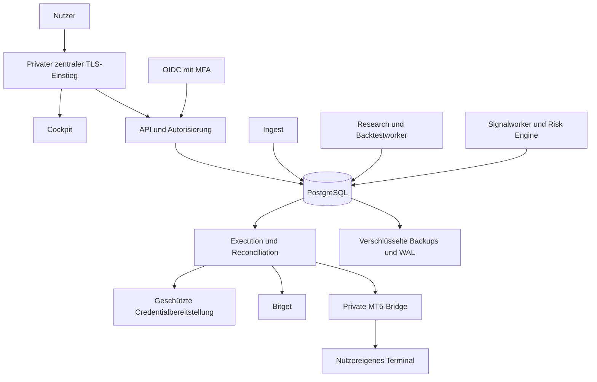
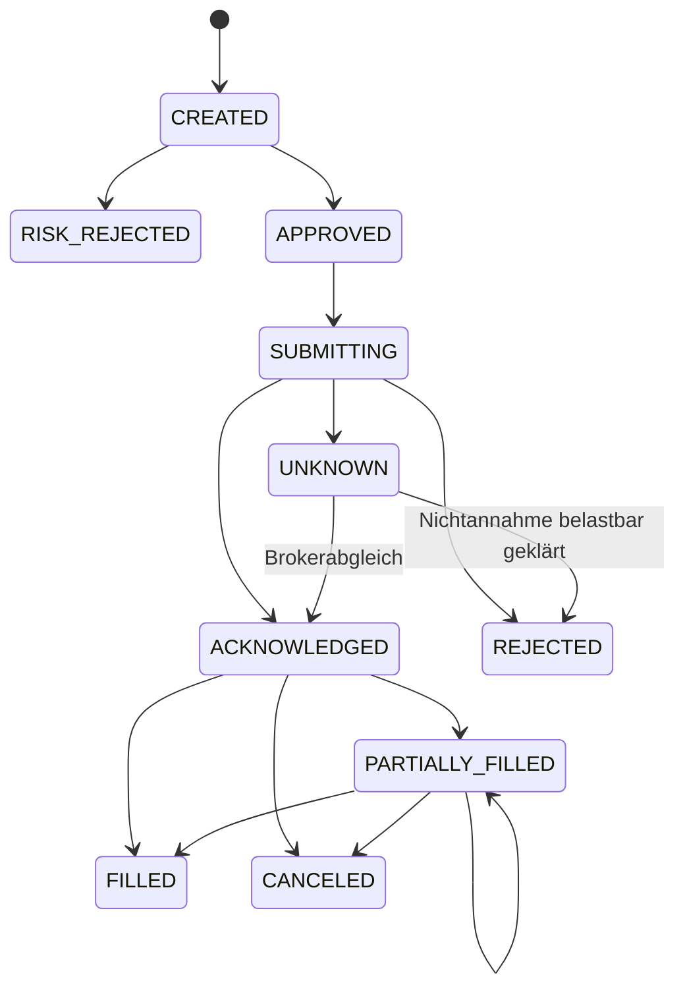

# Architektur- und Stackentwurf

Stand 2026-11-06. Q7 bestätigt den Grundstack aus Python/FastAPI,
Next.js/TypeScript, PostgreSQL und getrennten Workern im modularen Monolithen.
Weitere Technologieauswahlen hier sind **Vorschläge**.
Keine Frameworks, Images, Datenbanken oder CI/CD-Dienste wurden eingerichtet.
Begründungen und offizielle Belege: [sources.md](sources.md).

## Systemgrenzen

Bestätigt: modularer Monolith für API und Domäne, getrennte Prozesse für
zeitkritische Execution und ressourcenintensive Forschung. Keine anfängliche
Microservice-Infrastruktur; fachliche Verträge erlauben spätere Trennung.

Der fachliche Kern importiert weder FastAPI noch Broker-SDKs. API, Worker,
Simulator und Brokeradapter rufen denselben versionierten Strategievertrag auf.

## Technologieauswahl

API/Cockpit/Trading/PostgreSQL/persistente PostgreSQL-Jobs sind grundsätzlich
bestätigt. Konkrete Pins, Provider und alle übrigen Werkzeuge bleiben offen.
Q8 bestätigt eigene MFA-Anmeldung statt anfänglichem Website-SSO.

| Ebene | Vorschlag | Grund / Alternative |
|---|---|---|
| Cockpit | Next.js, React, TypeScript | Nähe zum Referenzstack; reines React-SPA wäre einfacher, wenn SSR keinen Nutzen hat |
| API | Python, FastAPI, Pydantic | Trading-/Researchökosystem und vorhandene Komponenten |
| Tradingkern | Typisiertes Python, dezimale Orderrechnung | Wiederverwendung; Performance gezielt messen statt verfrüht neu schreiben |
| Datenbank | PostgreSQL | Transaktionen, RLS, Outbox und PITR |
| Migrationen | Versionierte SQL-/Pythonmigrationen, Werkzeug noch prüfen | Keine automatischen destruktiven Schemaänderungen |
| Jobs | PostgreSQL-Jobtabelle/Outbox mit Leasing | Wenige Dienste; Redis/RabbitMQ erst bei nachgewiesenem Bedarf |
| Historien | PostgreSQL für operative Daten, Parquet für große immutable Forschungssnapshots | Retention und Lizenzen prüfen; TimescaleDB vorerst keine Pflicht |
| Charting | Bibliothek für eigene Daten, z. B. Lightweight Charts | Lizenz/Attribution und Exportbedarf vor Auswahl prüfen |
| Auth | OIDC mit MFA/Passkeys | Provider und SSO mit bestehendem Investalo-Login noch offen |
| Secrets | Envelope Encryption, unabhängige Schlüsselverwaltung | Provider/KMS/Tresor und Budget noch offen |
| Deployment | Reproduzierbare Container oder gehärtete systemd-Dienste | Entscheidung nach Kapazitätsprüfung; Docker fehlt derzeit |
| Monitoring | Strukturierte Logs, fachliche Metriken und Healthchecks | Konkrete Werkzeuge nach Ressourcen-/Betriebsentscheidung |
| CI/CD | Noch offen | Neue Toolabhängigkeiten erst nach Nutzerfreigabe |

Der kleine Host spricht gegen einen gleichzeitig laufenden großen Identity-,
Monitoring- und Researchstack. Externe Dienste sind ebenso wenig stillschweigend
freigegeben wie zusätzliche lokale Dienste.

### Konkrete Vorschläge für den privaten Start

Q13 schlägt gehärtete systemd-Dienste vor; Docker Engine/Compose ist auf
Ubuntu 26.04 offiziell unterstützt und bleibt eine unabhängige Alternative.
Beide brauchen getrennte Identitäten, Ressourcenlimits und einen zentralen
Einstieg. Containerisierung spart nicht automatisch Anwendungsspeicher.

Q14 schlägt Authelia lokal als fertigen OIDC-Provider vor: administrierte
Privatnutzer, Passwort plus TOTP/WebAuthn und `two_factor`-Clientpolicy.
Keine öffentliche Selbstregistrierung. In-Memory-Sessions für einen einzelnen
Host und eigene PostgreSQL-Rolle/-DB sind mögliche kleine Konfigurationen.
Ein Neustart kann Sessions beenden; Argon2 benötigt zusätzlichen Speicher je
parallelem Login. Herstellerwerte ersetzen keinen gemeinsamen Lasttest.

ZITADEL Cloud Free ist eine geprüfte Alternative mit MFA, aber externer
Identitätsverarbeitung, Quoten und kurzen Logs. Der eingebaute
SMTP-Weg ist für Test/Evaluation, deshalb muss produktiver Recovery-/Mailbetrieb
separat gelöst werden. Keinen Provideraccount einrichten, bevor die Variante
und Verarbeitung bestätigt sind.

Keycloak empfiehlt allein für einen kleinen produktionsfähigen Container
2 GB; authentik nennt mindestens 2 GB Host-RAM. Beide sind auf diesem gemeinsam
genutzten Host ohne zusätzliche Kapazität kein Ausgangsvorschlag.
Authelia-Passkey-Login wird nicht pauschal als allein ausreichende MFA gewertet:
die entsprechende Zwei-Faktor-Interpretation ist laut Docs experimentell.

### Versions- und Buildpolicy

Vor Codebootstrap: unterstützte Python-/Node-Versionen und Adapterkompatibilität
prüfen; Hostversionen sind Inventur, keine Laufzeitentscheidung.
Pakete erhalten exakte Versionspins plus committed Lockdateien/Hashes.
Container bekommen konkrete Version und Digest; keine `latest`, Major-only-Tags
oder `npm install || true`. JavaScript-Builds verwenden den Lockfile-Modus.

Der ausgewählte Stand wird mit Supportende, Quelle und Prüfdatum dokumentiert.
Updates gehen durch Änderungsprüfung und relevante Tests; Sicherheitsfixes
werden nicht durch unbegrenzt eingefrorene Pins verhindert.
Eine Softwarestückliste und Lizenzinventur sind spätere Abnahmeartefakte.

## Fachmodule und Datenmodell

| Modul | Zentrale Objekte |
|---|---|
| Identity/Tenants | Tenant, User, Membership, Role, Session-/Providerreferenz |
| Accounts | BrokerAccount, CapabilityProfile, CredentialReference |
| Market data | Instrument, Bar/Tick, DataQuality, DataSnapshot, CorporateAction |
| Strategies | StrategyVersion, Parameters, Deployment, Signal |
| Risk | RiskProfileVersion, Decision, CapitalReservation |
| Execution | OrderIntent, OutboxEvent, BrokerOrder, Fill, ExecutionAttempt |
| Portfolio/Journal | PositionSnapshot, EquitySnapshot, Cashflow, JournalEntry |
| Research | BacktestJob, Experiment, Artifact, Promotion |
| Information | NewsItem, CalendarEventVersion, MacroObservation |
| Audit | Actor, Target, Action, Timestamp, CorrelationID |

Tenants und Konten sind verschiedene Konzepte. Ein Tenant kann mehrere Konten
mit verschiedenen Währungen, Brokern und Regeln besitzen. Private Fachdaten
tragen `tenant_id`; kontobezogene Fremdschlüssel enthalten den Tenantbezug.
Öffentliche Referenzdaten bleiben nur bei passenden Lizenzrechten gemeinsam.

Geld/Preise/Mengen werden dezimal gespeichert; indikative Berechnungen können
kontrolliert Floats verwenden. Preis-, Mengen- und Gebührenrundung richten sich
nach dem Instrument. Zeit wird in UTC gespeichert, mit ursprünglicher
Brokerzeitzone und Event-/Empfangszeit zur Diagnose. Strategien, Risikoprofile
und Forschungsergebnisse sind immutable Versionen.

Fills und Cashflows bilden das nachvollziehbare Journal; Brokerkonto-Snapshots
prüfen es gegen die reale Welt. Korrekturen erzeugen nachvollziehbare
Folgeeinträge. Datenschutzlöschung und Auditaufbewahrung erhalten abgestimmte
Fristen; „immutable“ bedeutet kein unbegrenztes Speichern personenbezogener Daten.

## Mandantentrennung

Tenantkontext kommt aus authentifizierter Identität und geprüfter Mitgliedschaft,
nicht aus einem ungeprüften Header. Jede Anfrage, jeder Job, Export, Cachekey und
Stream wird mit diesem Kontext autorisiert.

PostgreSQL RLS ist eine zweite Schutzschicht. Runtime-Rollen besitzen keine
Tabellen, kein `BYPASSRLS`, Superuserrecht, DDL oder `TRUNCATE`. Policies verwenden
Read-/Writeprüfungen einschließlich `WITH CHECK`; bei fehlendem Kontext gilt
Default-deny. Ein geprüfter Kontext wird transaktionslokal gesetzt, damit
Connection-Pooling keinen Tenant weiterreicht. Migrationen laufen mit anderer
Identität. Composite Foreign Keys verhindern tenantübergreifende Beziehungen.

RLS schützt nicht allein gegen ein kompromittiertes Backend mit freiem SQL und
veränderbarem Tenantparameter. Parametrisierte Abfragen, begrenzte Rollen und
Isolations-/Negativtests bleiben notwendig. Höherer Isolationsbedarf kann später
eigene Datenbanken oder spezifische Rollen rechtfertigen.

Private API-/Cockpitantworten erhalten private Cachevorgaben.
WebSocket/SSE-Abonnements werden nach Authwechsel, Entzug oder Sessionende
neu geprüft beziehungsweise beendet.

## Schnittstellen

Vorschlag: versionierte HTTP-API für Benutzeraktionen; SSE für
Dashboardaktualisierungen, WebSockets nur wenn bidirektional erforderlich.
Ein Backteststart liefert Job-ID, Status und Abbruchmöglichkeit.
OpenAPI-/Schemaartefakte entstehen aus `packages/contracts/`.

Brokeradapter bieten Capabilities und Aktionen für Market Data, Account,
Orders, Fills, Positions, Protection und Reconciliation. Nicht unterstützte
Operationen werden explizit abgelehnt. Domainmodelle unterscheiden Orderabsicht,
Brokerannahme und tatsächlichen Fill.

MT5-Verträge enthalten Geräte-/Kontobindung, Command-ID, Ablaufzeit, Nonce,
Sequenz, Payloadversion und bestätigte Ausführungsergebnisse.
Transport-/Retry-/Replayregeln sind Teil des Vertrags.

## Orders, Konsistenz und Fehler

Signal, Riskentscheidung, Orderintent, Kapitalreservierung und Outboxeintrag
werden atomar geschrieben. Delivery ist mindestens einmal; Consumer verarbeiten
fachlich idempotent. `LISTEN/NOTIFY` kann wecken, ersetzt keine persistente Queue.

Teilgefüllte, dann stornierte Orders behalten ihre Fills. Restmengen und
Reservierungen werden separat abgeschlossen. Weitere Brokerzustände werden
explizit gemappt; die Skizze ist noch kein verbindliches Schema.

Ein Konto bekommt koordinierte Ausführung und atomare Reservierungen gegen
Überbuchung. Leases/Fencing verhindern konkurrierende lokale Worker; sie
garantieren nicht, dass ein bereits abgesendeter Brokerrequest verschwindet.
Die kanonische Brokerkontoidentität (Broker/UID/Subaccount beziehungsweise
MT5-Server/Login) erkennt doppelt angelegte Verbindungen desselben Bestands.
Solche Verbindungen oder mehrere Tenants dürfen keine parallelen Writer oder
unabhängigen, dadurch umgehbaren Risikobudgets erzeugen. Gemeinsame Marginpools
benötigen gemeinsame Risikoaggregation bei weiterhin korrekter Autorisierung.
Nach Timeout: `UNKNOWN`, neue riskante Aktionen gegebenenfalls sperren und
Order/Fills/Positionen abgleichen. Kein blindes Resend.

`clientOid` hilft bei Bitget, erfordert aber Prüfung pro Endpoint. MT5-Magic und
Ordercomment sind keine sichere Deduplizierung. Die Bridge braucht ein dauerhaftes
Journal, Kontoabgleich und Recovery für ungeklärte Kommandos.
WS-Ereignisse werden regelmäßig gegen REST-/Terminaldaten geprüft.

Risk Engine wird unmittelbar vor Dispatch erneut ausgeführt: Datenalter,
Kapital/Margin, bestehende Orders, Limits, Kontraktdaten, Handelszeit und
Kontoregeln können sich seit dem Signal geändert haben.
Schutzaktionen dürfen nicht hinter Backtestjobs in einer gemeinsamen Queue warten.

## Integrationsgrenzen

**MT5:** Die offizielle Pythonintegration verbindet mit einem laufenden Terminal.
Es ist keine direkte Ubuntu-Broker-REST-API. Hosting auf geeignetem nutzereigenem
Terminalhost, Geräteidentität und ausgehendem privaten Kanal klären.
Jedes Terminal ist fest an seinen Brokeraccount gebunden; kein unkontrolliertes
Kontoumschalten zwischen Tenantjobs.

**Bitget:** Classic/UTA, Spot/Derivate, Netting/Hedge, Cross/Isolated, Region,
Demo-/Livezugang und API-Familie müssen vor Implementierung bekannt sein.
Instrumentregeln, Maintenance-Stufen, Markpreis und Fundingintervalle werden
aus aktuellen Daten abgeleitet.

M1 kann echte Konten ausschließlich lesend anbinden. Paper führt lokal
simulierte Orders aus, Demo ausschließlich auf getrennten Demokonten.
Echtgeld-Dispatch ist serverseitig gesperrt; fehlende Tradingrechte der
M1-Echtkontocredentials bilden eine zusätzliche Grenze.

**AI:** Keine Brokerkeys oder Ordertools. News sind untrusted Eingaben.
Strukturierte Bewertungsverträge, Frist und versionierte Ausfallpolicy.
Promotion neuer Modelle erfolgt außerhalb des Livepfads.

## Skalierung

Zuerst Datenqualität und korrekte Ausführung; danach anhand gemessener Last
Backtests auf einen eigenen Host/Workerpool auslagern. Später Marktdatenpartitionen,
Cache, zusätzlicher Jobbroker oder separate Tenantdatenbanken bewerten.
Für echtes HA ist eine neue Betriebsentscheidung nötig; zwei Worker auf derselben
VM erzeugen keine Hostverfügbarkeit.
