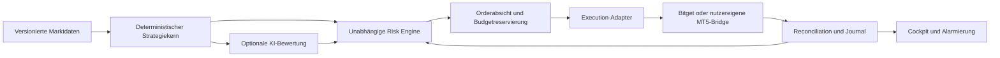

# Projektkonzept

Stand: 2026-11-07. **Vollständiger Planungsentwurf, noch nicht zur Implementierung
freigegeben.** Grundstack, beide Broker im MVP, Startvarianten,
Docker Compose und lokales Authelia sind in Q6–Q14 bestätigt.
Q15–Q22 konkretisieren Signale, Schutz, Paper-/Demolimits,
öffentlichen HTTPS-Einstieg für Privatnutzer und vorhandenen SMTP.
Ausgangspunkt ist [project-info.md](project-info.md). Bestätigte
Anforderungen und noch offene Entscheidungen werden getrennt geführt.

## Ziel und Erfolgskriterien

Investalo bündelt Konten, Marktinformationen, Strategieentwicklung und
automatisierte Ausführung in einem Cockpit. Bitget und MT5 sind geforderte
Integrationen; weitere Märkte folgen über denselben Adaptervertrag.

Das wirtschaftliche Ziel ist ein belastbarer positiver Nettoerwartungswert unter
verbindlichen Risikogrenzen. Dauerhafte Gewinne kann kein System garantieren.
Selbstlernen bedeutet deshalb zunächst kontrollierte Forschung mit messbarem
Nutzen, unabhängiger Validierung und Rücknahme schlechter Änderungen.

Erfolg wird getrennt bewertet:

| Dimension | Nachweis vor Freigabe |
|---|---|
| Wirtschaftlichkeit | Kostenbereinigte Out-of-Sample-Ergebnisse, Unsicherheit, Kapitalbindung und geeignete Benchmark |
| Risiko | Drawdown-/Expositionsgrenzen, Stressfälle und kontospezifische Regelkonformität |
| Zuverlässigkeit | Keine Doppelorders im getesteten Fehlermodell; Abgleich unklarer Ausführung |
| Sicherheit | Mandantentrennung, minimale Rechte, geschützte Schlüssel und getesteter Restore |
| Produkt | Verständliche Portfolio-/Risikodarstellung und vollständiger Backtestablauf |
| Betrieb | Messbare Datenfrische, Alarmierung, Backup und dokumentierter Wiederanlauf |

Konkrete Schwellen, Stichprobengrößen und SLOs entstehen im Interview und werden
vor Optimierung eingefroren. Ein gutes Backtestergebnis allein ist keine
Freigabe für echten Handel.

## Umfang und vorgeschlagene Reihenfolge

**Gefordert:** Multiuserfähigkeit, Portfolio und Kontostatistiken, offene
Positionen, automatisches Journal, Backtesting mit grafischen Ergebnissen,
Marktinformationen und News, Wirtschaftskalender, API-Key-Einrichtung,
Bitget/MT5, KI-Unterstützung und autonome Ausführung.

**In Q1/Q2 bestätigt für den ersten Release:** private Einladung, Mandantentrennung von
Beginn an, Cockpit mit echter lesender Kontenanbindung, eine vollständig
spezifizierte Strategie je Brokerpfad, reproduzierbare Backtests und Paperbetrieb.
Q6 bestätigt Bitget und MT5 parallel im ersten Release.
Q9/Q10 bestätigen BTC/ETH Spot ohne Hebel auf H4 und XAUUSD Trend/Pullback
mit H1-Trendregime/M15-Einstiegen. RSI14/Wilder, Supertrend ATR10/Wilder ×3
und Paper-/Demolimits sind in Q15/Q17–Q19 bestätigt.
Die sechste Crypto-Tranche bleibt ausschließlich gesonderte Notfallreserve;
deren Auslöser ist Q23. Q20 plant öffentlichen HTTPS-Zugang schon für den
Privatpilot, ohne öffentliche Registrierung oder interne Serviceports.

Die genaue M1-Abgrenzung von echten KI-/News-/Kalenderfeeds und die ausdrückliche
Verlagerung späterer Echtgeld-/FTMO-/Providerentscheidungen stehen in Q28
zur Bestätigung. Keine stille Kürzung des ursprünglichen Gesamtauftrags.

Öffentliches Kundenangebot, Abrechnung, mehrere Regionen, weitere Broker und
vollautomatische Strategiepromotion folgen nach separater Entscheidung.
Portfolioübersicht kann verschiedene Märkte darstellen, ohne alle sofort
automatisch handeln zu müssen.

## Nutzer, Konten und Berechtigungen

Ein Nutzer kann Mitglied mehrerer Mandanten sein. Ein Mandant besitzt
Brokerkonten, Konfigurationen und Journale; Berechtigungen werden pro Mitglied
und bei Bedarf pro Konto geprüft.

Vorgeschlagene Rollen:

| Rolle | Fähigkeiten |
|---|---|
| Owner | Mitglieder, Konten und Freigaben verwalten |
| Trader | Freigegebene Strategien konfigurieren und kontrolliert starten/stoppen |
| Analyst | Forschung/Backtests und lesende Auswertung |
| Viewer | Lesende Übersicht |
| Platform operator | Technischer Betrieb, kein pauschaler Zugriff auf entschlüsselte Brokerkeys |

Ein initialer Privatbetrieb kann Rollen vereinfachen, darf Tenantkontext und
Autorisierung aber nicht später aufsetzen müssen. Supportzugriffe benötigen
begrenzte, dokumentierte Freigaben.

## Cockpit und Bedienabläufe

Die Oberfläche orientiert sich an `www.investalo.de`. Farben, Typografie,
Logoverwendung und vorhandene Login-/Designsysteme werden inventarisiert und
vor Umsetzung abgestimmt; im Entwurf werden keine Farbwerte erfunden.
Deutsch ist als Startsprache vorgeschlagen; UTC wird intern gespeichert,
Darstellung berücksichtigt Nutzer- und Brokerzeitzonen.

| Bereich | Inhalt und Bedienung |
|---|---|
| Übersicht | Gesamtequity, Cash, gebundene Margin, Exposition, Drawdown und Tagesergebnis |
| Konten | Broker-/Kontomodus, letzte Synchronisierung, Balance/Equity, Limits und Verbindung |
| Positionen | Nettomenge, reale Fills, Durchschnitt, SL/TP, Liquidationsabstand und Strategie |
| Portfolio | Asset-/Währungs-/Marktaufteilung, korrelierte Risiken und Equityverlauf |
| Strategien | Version, Status, Parameter, Budget, Freigabestand und erklärbare Signale |
| Backtests | Asset, Zeitraum, Zeitrahmen, Datenqualität, Strategieversion und Kostenannahmen |
| Ergebnisse | Equity/Drawdown, Trades, Verteilung, Kosten, Vergleich und Stressszenarien |
| Journal | Signal → Riskentscheidung → Order → Fills, Kosten, Gründe und Notizen |
| Markt | Nach Anlageklasse sortierte Makrodaten, Kalender, News und Quellenalter |
| Einstellungen | Mitglieder, MFA, Kontoverbindungen, maskierte Schlüssel und Benachrichtigungen |

Detailoverlays zeigen die zugrunde liegenden Fills und Risikoprüfungen, ohne die
Übersicht zu überladen. Mobile Ansichten erhalten dieselben Schutzmaßnahmen.
Live-/Paper-/Backtestmodus und Datenalter sind überall eindeutig sichtbar.
Tastaturbedienung, Kontrast und nicht ausschließlich farbliche Statusanzeigen
gehören zur Abnahme.

**Kontoeinrichtung:** Login/MFA → Broker-/Kontotyp wählen → minimale API-Rechte
prüfen → Schlüssel verschlüsselt übernehmen → lesende Verbindung testen →
Kontoprofil und Risikogrenzen prüfen → Paper aktivieren. Live erfordert später
eine ausdrückliche konto- und strategiebezogene Freigabe.

**Backtest:** Version/Asset/Zeitfenster wählen → verfügbare Historie und Kosten
anzeigen → Job mit Ressourcenlimit starten → Fortschritt/Abbruch → immutable
Ergebnis mit Provenienz, Charts und Export. Ein Export gehört zum eigenen
Mandanten und bleibt nur befristet abrufbar.

**Portfolio:** Kontostände werden mit FX-Quelle und Zeitstempel in eine
Berichtswährung umgerechnet. Ein-/Auszahlungen, Transfers und Trading-PnL werden
getrennt. Mehrere Konten desselben wirtschaftlichen Bestands dürfen in der
Gesamtsicht nicht doppelt gezählt werden. Realized/unrealized PnL, Gebühren,
Funding und Swap bleiben nachvollziehbar; Performance berücksichtigt externe
Cashflows, statt Einzahlungen als Gewinn zu zählen.

## Handelsablauf

AI kann nur innerhalb einer bestätigten Policy bewerten oder vetoieren.
Risikoentscheidungen und Schutzorders dürfen nicht auf eine langsame
KI-Antwort warten. Externe Ausführung hat keine Exactly-once-Garantie;
Timeouts erfordern Abgleich.

## Märkte und Daten

Die Datenquelle für Ausführungsentscheidungen muss zum gehandelten Instrument
passen: Bitget für dortige Instrumente, MT5/Broker für dortige Bid-/Ask-/Tickdaten.
Chart- oder Referenzdaten sind nicht automatisch brokeridentische Preise.

| Daten | Vorgeschlagene Quelle / Einordnung |
|---|---|
| Crypto Quotes, Instrumentregeln, Orders | Aktuelle Bitget-API passend zu Classic/UTA und Spot/Derivaten |
| Forex, Gold, Brokerkonto | MT5-Terminalbridge, Historienexport und Symbolmetadaten |
| Ergänzende Historien/Makro | Alpha Vantage / Twelve Data innerhalb Lizenz und Quote |
| Fear & Greed | Anbieterwahl und Lizenz noch offen; Aktualitätskennzeichnung |
| COT | CFTC-Veröffentlichungen; Veröffentlichungszeit statt Berichtsdatum für Signale |
| Zentralbankzinsen | Offizielle Zentralbankdaten mit Quelle und Gültigkeit |
| Wirtschaftskalender | Lizenzierter Feed mit Ereignisversionen, Zeit und betroffenen Märkten |
| News | Lizenzierte Feeds oder erlaubte RSS-Auszüge, Deduplizierung und Quellenlinks |
| Charts | Eigene lizenzierte Daten; Chartbibliothek und Attribution separat prüfen |

Alpha Vantage Free ist mit derzeit 25 Requests/Tag keine Live-Trading-Grundlage.
Twelve Data Basic hat begrenzte Minuten-/Tagescredits und eingeschränkte
Entitlements. TradingView Essentials ist kein allgemeiner Daten-API-Zugang;
automatisches Trading aus dessen Daten darf nicht ohne geklärte Nutzungsrechte
eingeplant werden. Details und offizielle Belege: [sources.md](sources.md).

Ingest braucht Quotensteuerung, Backfill, Duplikaterkennung, Lückenprüfung und
reproduzierbare Snapshots. Feeds werden mit Quelle, Lizenz, Instrument,
Zeitauflösung, Event-/Empfangszeit und Qualitätsstatus registriert.
Geteilte Daten benötigen Rechte zur Multiuseranzeige.

## Wiederverwendung und Migration

Die Referenzrepos liefern StrategyPlugins, MT5-Reporting, Order-EA,
Persistenz-/Abgleichideen, Historienimport und Backtestwerkzeuge. Sie werden
zunächst read-only bewertet. Auth/Mandantentrennung, Risikoprüfungen und
Kosten-/Fillmodelle benötigen gezielte Überarbeitung.

Übernahme erfolgt komponentenweise mit Quellencommit, Lizenzprüfung,
Vertragstests und neu gepinnten Abhängigkeiten. Alte und neue Ausführung dürfen
nie gleichzeitig dasselbe Konto steuern. Eine spätere Umschaltung braucht
Schattenvergleich, vollständigen Brokerabgleich und Rückfallplan.
Siehe [inventory.md](inventory.md).

## Lernen, Optimierung und Governance

Der Forschungszyklus verbindet Journal, Datenqualität und Marktregime:
Hypothese → eingefrorene Daten → Training/Validierung → unabhängiger Holdout →
Stress-/Kostenprüfung → Shadow/Paper → freigegebener begrenzter Livepilot →
laufende Überwachung. Experimente protokollieren auch verworfene Kandidaten,
damit Mehrfachtests und Auswahlverzerrung sichtbar bleiben.

Parameter dürfen nicht allein wegen der letzten Verlustserie automatisch
wechseln. Drift-/Degradationsalarme führen zuerst zu Prüfung beziehungsweise
Expositionsstopp; Promotion und Rollback sind versionierte Entscheidungen.
Details: [trading.md](trading.md).

## Betrieb und wirtschaftliche Tragfähigkeit

Ein modularer Monolith mit getrennten Workern ist als Grundarchitektur bestätigt.
Der vorhandene 2-GB-Host eignet sich für Planung und begrenzte Entwicklung.
Produktionskapazität wird gemessen; umfangreiche Backtests werden zeitlich oder
räumlich vom kritischen Handel getrennt. Ein Einzelserver bleibt ein Ausfallpunkt.

Kosten werden in Infrastruktur, Datenlizenzen, Identity/Secrets, Backups,
Monitoring und KI aufgeteilt. Q5 bestätigt zunächst kostenlose externe
Tools/Accounts; TradingView Essentials ist das bestehende bezahlte Werkzeug.
Keine zusätzlichen Dienste sind gebucht. Jeder benötigte Dienst wird auf
Leistungsgrenzen, Rechte und Datenschutz geprüft. Zusätzliche Kosten brauchen
eine neue konkrete Abstimmung.

Für ein späteres Kundenangebot sind Datenschutz, AV-Verträge, Aufbewahrung,
Datenlizenzen sowie die rechtliche Einordnung der angebotenen Handelsleistung
zu klären. Besonders FTMO erlaubt nicht automatisch zentralen Handel auf
fremden Konten. Ein Privatpilot ersetzt diese Prüfung nicht.

## Umsetzung und Freigaben

[roadmap.md](roadmap.md) definiert Phasen und Abnahme, [tasks/board.md](tasks/board.md)
die ausführbaren Tickets. [interview.md](interview.md) dokumentiert Abhängigkeiten
und Entscheidungen. Technische Vertiefungen: [architecture.md](architecture.md),
[security.md](security.md), [operations.md](operations.md).

Aktuell autorisiert sind Bestandsaufnahme, Dokumentation und Projektstruktur.
Nächster Umsetzungsschritt nach dem Interview ist die Auswahl und das exakte
Pinning des bestätigten Stacks. Produktion, echte Brokerorders und kostenpflichtige
Buchungen sind gesonderte Freigaben.
