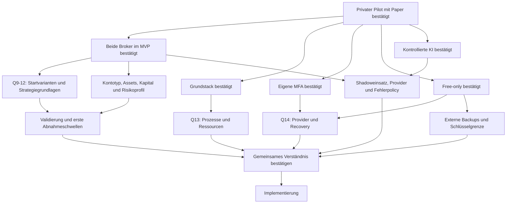

# Interview und Entscheidungsbaum

Skill: [grill-me](../SKILLS/grill-me/SKILL.md). Fragen werden in Runden entlang
bereits geklärter Voraussetzungen gestellt. „Ja“ akzeptiert die jeweils
genannte Empfehlung. Unbeantwortete Fragen bleiben offen.

Stand 2026-11-06: Runden 1 und 2 beantwortet; Runde 3 gestellt.
Eine Abschlussbestätigung des gemeinsamen Verständnisses steht noch aus.
Struktur und Planungsdokumente sind ausdrücklich beauftragt; Implementierung
des Entwurfs beginnt erst nach den erforderlichen Entscheidungen.

## Bestätigte Entscheidungen — Runde 1

| Frage | Nutzerentscheidung | Konsequenz |
|---|---|---|
| Q1 Erster Meilenstein | Ja: Cockpit, reproduzierbare Backtests und Paper zuerst | Kein Echtgeld als MVP-Abnahme; spätere Livefreigabe |
| Q2 Nutzerkreis | Ja: erst privat starten | Einladung/privater Zugriff; Tenantmodell von Beginn an |
| Q3 Risikogrenzen | Ja, unbedingt | Tages-/Gesamt-/Positions-/Hebellimits unabhängig von Strategie/AI |
| Q4 KI/Selbstlernen | Ja | Offlineverbesserung und geprüfte Promotion statt unkontrollierter Liveänderung |
| Q5 Betrieb/Kosten | Vorhandener Server, Free-Tools/-Accounts; nur TradingView Essentials bezahlt | Keine neuen bezahlten Dienste buchen; Gratisquoten/Rechte und Kapazität prüfen |

Die Serverfreigabe ist keine pauschale Freigabe für Produktionsdeployment,
Echtgeldorders, destruktive Änderungen oder weitere kostenpflichtige Accounts.

## Bestätigte Entscheidungen — Runde 2

| Frage | Nutzerentscheidung | Konsequenz |
|---|---|---|
| Q6 Brokerumfang | Beide gleichzeitig für den ersten Release planen | Bitget und MT5 im MVP; erste konkrete Varianten noch wählen |
| Q7 Architektur/Stack | Ja zum vorgeschlagenen Stack | Modularer Monolith, getrennte Worker, Python/FastAPI, Next.js/TypeScript, PostgreSQL/Jobs |
| Q8 Identitygrenze | Ja zur eigenen MFA-Anmeldung | Website-SSO später; Providerwahl noch offen |

## Aktuelle Frontier — Runde 3

| Frage | Konkrete Empfehlung | Status |
|---|---|---|
| Q9 Crypto-Startumfang | BTC/USDT und ETH/USDT, Bitget Spot ohne Hebel, H4 | Offen |
| Q10 MT5-Startstrategie | XAUUSD Trend/Pullback, H1-Regime/M15-Entry nach Risk-/Kosten-/Kausalitätsprüfung | Offen |
| Q11 Crypto-Vorlage | Schriftlicher Prompt geht vor älterer Bildreferenz | Offen |
| Q12 Staffel/Preisbezug | Quote-Budget +25 %, Abstand zum letzten Fill, −50 % zum ersten Fill | Offen |
| Q13 Prozessmodell | Gehärtete systemd-Dienste statt anfänglicher Dockerinstallation | Offen |
| Q14 Identityprovider | Lokal Authelia mit Passwort + TOTP/WebAuthn, Privatnutzer administriert | Offen |

Antworten über das Interview übernehmen; keine implizite Zustimmung aus
Zeitablauf oder aus einer Zustimmung zu anderen Fragen ableiten.

## Entscheidungsbaum

## Folgefragen nach Voraussetzung

Diese Punkte sind **noch nicht gestellte, abhängige Fragen**:

- Nach Q9/Q11/Q12: RSI-/ATR-/Supertrendparameter, Rearm, Pufferauslöser,
  erster Schutzstop, Notausstieg und konkrete Kapital-/Risikogrenzen.
- Nach Q10: Broker-/Kontoprofil, FTMO-Phase falls relevant,
  Terminalhosting, lokaler Betrieb und Datenhistorie.
- Nach Markt-/Kontotyp: erste Paperkapitalbasis und konkrete Risikolimits.
  Echtgeldbetrag/Livekriterien können nur ausdrücklich an ein späteres Gate
  delegiert werden, niemals stillschweigend angenommen.
- Nach Q13: gepinnte Laufzeiten, Hostressourcen und
  Priorisierung von Entwicklung/Research/Live.
- Nach Q14: MFA-Recovery, Datenverarbeitung und späterer SSO-Pfad.
- Nach Betriebswahl: tolerierbare Ausfälle, kostenlose externe Sicherung,
  Schlüsselwiederherstellung und Alarmierungswege.
- Nach erstem Strategiepfad: AI zunächst deaktiviert/Shadow/Veto,
  erlaubte Daten, kostenloser Provider und Timeoutpolicy.
- Nach formaler Strategie: Mindestdatenmenge, Kostenmodell,
  Benchmark und Abnahmekriterien vor Optimierung.

Umweltfakten recherchieren die Agents selbst. Entscheidungen und Risikotoleranz
gehören dem Nutzer. Offene Fakten dürfen abhängige Fragen verzögern, aber
unabhängige Planung nicht blockieren.
