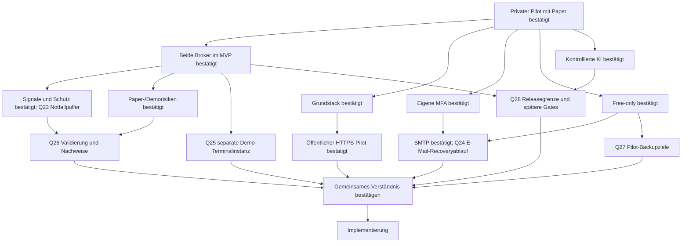

# Interview und Entscheidungsbaum

Skill: [grill-me](../SKILLS/grill-me/SKILL.md). Fragen werden in Runden entlang
bereits geklärter Voraussetzungen gestellt. „Ja“ akzeptiert die jeweils
genannte Empfehlung. Unbeantwortete Fragen bleiben offen.

Stand 2026-11-07: Runden 1–4 beantwortet; Runde 5 (Q23–Q28) gestellt.
Eine Abschlussbestätigung des gemeinsamen Verständnisses steht noch aus.
Struktur und Planungsdokumente sind ausdrücklich beauftragt; Implementierung
des Entwurfs beginnt erst nach den erforderlichen Entscheidungen.

## Bestätigte Entscheidungen — Runde 1

| Frage | Nutzerentscheidung | Konsequenz |
|---|---|---|
| Q1 Erster Meilenstein | Ja: Cockpit, reproduzierbare Backtests und Paper zuerst | Kein Echtgeld als MVP-Abnahme; spätere Livefreigabe |
| Q2 Nutzerkreis | Ja: erst privat starten | Privater Nutzerkreis per Einladung; Tenantmodell von Beginn an; öffentlicher HTTPS-Einstieg in Q20 gewählt |
| Q3 Risikogrenzen | Ja, unbedingt | Tages-/Gesamt-/Positions-/Hebellimits unabhängig von Strategie/AI |
| Q4 KI/Selbstlernen | Ja | Offlineverbesserung und geprüfte Promotion statt unkontrollierter Liveänderung |
| Q5 Betrieb/Kosten | Vorhandener Server, Free-Tools/-Accounts; nur TradingView Essentials bezahlt | Keine neuen bezahlten Dienste buchen; Gratisquoten/Rechte und Kapazität prüfen |

Die Serverfreigabe ist keine pauschale Freigabe für Produktionsdeployment,
Echtgeldorders, destruktive Änderungen oder weitere kostenpflichtige Accounts.

## Bestätigte Entscheidungen — Runde 2

| Frage | Nutzerentscheidung | Konsequenz |
|---|---|---|
| Q6 Brokerumfang | Beide gleichzeitig für den ersten Release planen | Bitget und MT5 im MVP; Varianten in Q9/Q10 bestätigt |
| Q7 Architektur/Stack | Ja zum vorgeschlagenen Stack | Modularer Monolith, getrennte Worker, Python/FastAPI, Next.js/TypeScript, PostgreSQL/Jobs |
| Q8 Identitygrenze | Ja zur eigenen MFA-Anmeldung | Website-SSO später; lokales Authelia in Q14 bestätigt |

## Bestätigte Entscheidungen — Runde 3

| Frage | Nutzerentscheidung | Konsequenz |
|---|---|---|
| Q9 Crypto-Startumfang | Ja: BTC/USDT und ETH/USDT, Spot ohne Hebel, H4 | H1/Derivate spätere eigene Varianten |
| Q10 MT5-Startstrategie | Ja: vorhandenes XAUUSD Trend/Pullback | H1-Regime/M15-Entry; Risk-/Kosten-/Kausalitätsprüfung vor Übernahme |
| Q11 Crypto-Vorlage | Ja: schriftlicher Projektprompt maßgeblich | Abweichende Bildregeln nicht übernehmen |
| Q12 Staffel/Preisbezug | Ja: Geldbeträge und vorgeschlagene Preisbezüge | Quote-Budget +25 %, Abstand letzter tatsächlicher Fill, −50 % erster Fill |
| Q13 Prozessmodell | Docker Compose von Beginn an | systemd-Vorschlag verworfen; keine Dockerinstallation erfolgt |
| Q14 Identityprovider | Ja: lokale MFA aus der angebotenen Variante | Authelia OIDC, Passwort + TOTP/WebAuthn, administrierte Privatnutzer |

Antworten über das Interview übernehmen; keine implizite Zustimmung aus
Zeitablauf oder aus einer Zustimmung zu anderen Fragen ableiten.

## Bestätigte Entscheidungen — Runde 4

Die Antworten bestätigen Paper-/Demowerte, keine Echtgeldlimits.
Abweichungen von Empfehlungen werden ausdrücklich übernommen.

| Frage | Nutzerentscheidung | Konsequenz |
|---|---|---|
| Q15 Crypto-Signale | Ja: RSI14/Wilder, abgeschlossene H4-Kerzen | Erster Kauf nach zwei `<30`-Kerzen; danach Rearm `>30` und eine `<30`-Kerze plus 5%-Preisbedingung; genau 30 kein Trigger |
| Q16 Puffereinstieg | Abweichung: ausschließlich gesonderter Notfall | Fünf reguläre Stufen; sechste Reserve nicht als normaler Nachkauf; Schwelle und RSI-Ausnahme erst Q23 |
| Q17 Gewinnschutz | Ja: Supertrend ATR10/Wilder ×3 und vorgeschlagene Schutzregeln | Aktivierung ab +5 % verkaufbarem Kurs zum tatsächlichen Durchschnitt; Nettobreakeven-Untergrenze, monotones Trailing, keine Nachkäufe danach, kein zusätzlicher Flipexit |
| Q18 Crypto-Paperprofil | Ja einschließlich −55%-Notausstieg | 10.000 virtuelle USDT; je 500 Kaufprincipal +5 Kostenreserve; 6 % Tages-/8 % Startkapitalverlust; Tagesbasis Equity 00:00 UTC, Gesamtbasis Startkapital |
| Q19 MT5-Demoprofil | Ja: getrenntes Brokerdemo mit vorgeschlagenen Limits | 0,25 % modelliertes Ideenrisiko, höchstens eine Idee, 1 % Tages-/5 % Startkapitalverlust; Tageswechsel Europe/Prague; Lots abrunden |
| Q20 Pilotzugriff | Abweichung: öffentlicher zentraler HTTPS-Einstieg schon im Privatpilot | Privater Nutzerkreis, öffentlicher Proxy; interne DB/Worker; tatsächlicher Rollout separat freigeben |
| Q21 MFA-Mailweg | Ja: vorhandener kostenloser SMTP-Zugang | TLS, Absenderrechte und Zustellung prüfen; noch keine externen Nachrichten |
| Q22 MFA-Recovery | Abweichung: andere Methode, z. B. E-Mail reicht | E-Mail als gewünschter ausreichender Identitätsnachweis; konkrete administrative Umsetzung und Einschränkungen Q24 |

Q16 genehmigt **keine** bestimmte Notfallschwelle und keine automatische
RSI-Umgehung. Q22 genehmigt **keinen** beliebigen automatischen Reset oder
Adresswechsel. Die gewünschte E-Mail-Recovery ist schwächer als ein unabhängiger
Ersatzfaktor: Ein kompromittiertes Postfach könnte einen Reset ermöglichen.
Authelia bietet bei strenger Faktoränderungspolicy keinen fertigen
Mail-only-Selbstservice; Quellen und vorgeschlagener Ablauf stehen in
[deployment-plan.md](deployment-plan.md).

## Aktuelle Frontier — Runde 5

Q23–Q28 sind gestellt, noch nicht beantwortet. Die Empfehlungen bleiben offen.

| Frage | Konkrete Empfehlung | Status |
|---|---|---|
| Q23 Gesonderter Notfallpuffer | Erst nach fünf regulären Stufen, einmalig bei geschlossenem H4-Kurs ≤60 % erster Fill und ≤95 % fünfter Fill; ausdrücklich ohne RSI/Rearm, begrenzter Kaufpreis; −55%-Exit und Risiko gehen vor | Offen |
| Q24 E-Mail-Recoveryablauf | Administrativer Reset nach kurzer Einmalchallenge an bestehende Adresse; keine Adressänderung; Sitzungen/Token entziehen, neuen MFA-Faktor erzwingen; normale Faktoränderung weiterhin mit MFA | Offen |
| Q25 MT5-Terminalbetrieb | Zusätzliche Demo-Terminalinstanz auf vorhandenem MT5-Rechner mit neuer ausgehender HTTPS-EA-Bridge; bestehendes System in eigener Instanz | Offen |
| Q26 Validierungsmaßstab | Ziel ≥3 Jahre Crypto/≥2 Jahre brokerpassendes Gold; chronologische getrennte Fenster/ungeöffneter Holdout; im unabhängigen Holdout positiver Nettoertrag, PF ≥1,2, ≥30 geschlossene Baskets je Crypto-Asset bzw. ≥100 Goldtrades für wirtschaftliche Eignung | Offen |
| Q27 Pilot-Sicherungsziele | RPO 24 Stunden/RTO 4 Stunden; tägliche verschlüsselte externe Sicherung, zusätzliche geschützte Offlinekopie und getrennte Schlüssel; Ziel vor Pilotfreigabe konkret prüfen | Offen |
| Q28 Releasegrenze und spätere Gates | M1 Cockpit/MFA/Tenants/Portfolio/Journal/Backtests/beide Paper-/Demopfade; echte KI und vollständige News-/Kalenderfeeds danach; Echtgeld/FTMO/AI-Provider/Kundenbetrieb ausdrücklich später entscheiden | Offen |

Q23 ist eine neue Versuchsanordnung, kein nachgewiesenes Optimum. Der Puffer
senkt den Einstand, erhöht aber Verlustexposition gegenüber ungenutztem Cash.
Q26 trennt technische Paperbeobachtung von wirtschaftlicher Eignung; zu wenig
Historie/Trades ist kein bestandenes Ergebnis. Trainings-/Validierungszahlen
ersetzen die Mindeststichprobe im unabhängigen Holdout nicht. Diese Schwellen
sind ein vereinbarbarer Forschungsfilter, kein statistischer Gewinnbeweis.
Tatsächliche verfügbare Historie
und Terminalhost sind nicht aus den inventarisierten Dateien belegt.

## Entscheidungsbaum

## Folgefragen nach Voraussetzung

Nach der aktuellen Runde werden nur von den Antworten abhängige Entscheidungen
weitergeführt. Bei Zustimmung zu Q28 liegen Echtgeld-/FTMO-/AI-Provider- und
Kundenentscheidungen ausdrücklich an späteren Gates. Der Interviewabschluss
braucht weiterhin die Bestätigung des gemeinsamen Verständnisses.

Konkrete Umsetzungsfakten recherchieren wir: unterstützte Versionen exakt pinnen,
Historienlänge/-qualität prüfen, Brokerkosten/Metadaten und Hostlast messen.
Vor Pilotrollout müssen Domain/TLS, SMTP/Empfänger, Terminalbindung,
externes Backupziel/Schlüssel und Recoverytests konkret geprüft sein. Eine
Planentscheidung veröffentlicht keine Dienste und versendet keine Nachrichten.

Umweltfakten recherchieren die Agents selbst. Entscheidungen und Risikotoleranz
gehören dem Nutzer. Offene Fakten dürfen abhängige Fragen verzögern, aber
unabhängige Planung nicht blockieren.
