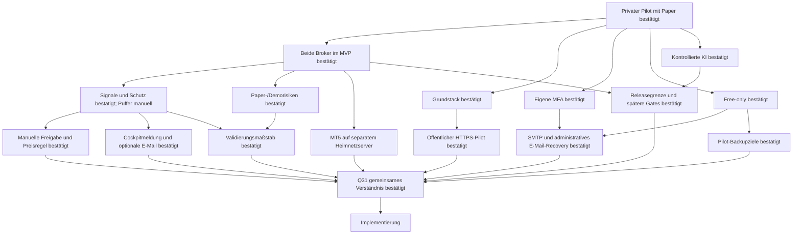

# Interview und Entscheidungsbaum

Skill: [grill-me](../SKILLS/grill-me/SKILL.md). Fragen werden in Runden entlang
bereits geklärter Voraussetzungen gestellt. „Ja“ akzeptiert die jeweils
genannte Empfehlung. Unbeantwortete Fragen bleiben offen.

Stand 2026-11-07: Runden 1–6 (Q1–Q30) beantwortet.
Q31 bestätigt das gemeinsame Verständnis und beauftragt den Umsetzungsstart.
Struktur und Planungsdokumente sind ausdrücklich beauftragt; Implementierung
des Entwurfs beginnt erst nach den erforderlichen Entscheidungen.

## Bestätigte Entscheidungen — Runde 1

| Frage | Nutzerentscheidung | Konsequenz |
|---|---|---|
| Q1 Erster Meilenstein | Ja: Cockpit, reproduzierbare Backtests und Paper zuerst | Kein Echtgeld als MVP-Abnahme; spätere Livefreigabe |
| Q2 Nutzerkreis | Ja: erst privat starten | Privater Nutzerkreis per Einladung; Tenantmodell von Beginn an; öffentlicher HTTPS-Einstieg in Q20 gewählt |
| Q3 Risikogrenzen | Ja, unbedingt | Tages-/Gesamt-/Positions-/Hebellimits unabhängig von Strategie/AI |
| Q4 KI/Selbstlernen | Ja | Offlineverbesserung und geprüfte Promotion statt unkontrollierter Liveänderung |
| Q5 Betrieb/Kosten | Vorhandener Server, Free-Tools/-Accounts; nur TradingView Essentials bezahlt | Keine neuen bezahlten Dienste buchen; Gratisquoten/Rechte und Kapazität prüfen |

Die Serverfreigabe ist keine pauschale Freigabe für Produktionsdeployment,
Echtgeldorders, destruktive Änderungen oder weitere kostenpflichtige Accounts.

## Bestätigte Entscheidungen — Runde 2

| Frage | Nutzerentscheidung | Konsequenz |
|---|---|---|
| Q6 Brokerumfang | Beide gleichzeitig für den ersten Release planen | Bitget und MT5 im MVP; Varianten in Q9/Q10 bestätigt |
| Q7 Architektur/Stack | Ja zum vorgeschlagenen Stack | Modularer Monolith, getrennte Worker, Python/FastAPI, Next.js/TypeScript, PostgreSQL/Jobs |
| Q8 Identitygrenze | Ja zur eigenen MFA-Anmeldung | Website-SSO später; lokales Authelia in Q14 bestätigt |

## Bestätigte Entscheidungen — Runde 3

| Frage | Nutzerentscheidung | Konsequenz |
|---|---|---|
| Q9 Crypto-Startumfang | Ja: BTC/USDT und ETH/USDT, Spot ohne Hebel, H4 | H1/Derivate spätere eigene Varianten |
| Q10 MT5-Startstrategie | Ja: vorhandenes XAUUSD Trend/Pullback | H1-Regime/M15-Entry; Risk-/Kosten-/Kausalitätsprüfung vor Übernahme |
| Q11 Crypto-Vorlage | Ja: schriftlicher Projektprompt maßgeblich | Abweichende Bildregeln nicht übernehmen |
| Q12 Staffel/Preisbezug | Ja: Geldbeträge und vorgeschlagene Preisbezüge | Quote-Budget +25 %, Abstand letzter tatsächlicher Fill, −50 % erster Fill |
| Q13 Prozessmodell | Docker Compose von Beginn an | systemd-Vorschlag verworfen; keine Dockerinstallation erfolgt |
| Q14 Identityprovider | Ja: lokale MFA aus der angebotenen Variante | Authelia OIDC, Passwort + TOTP/WebAuthn, administrierte Privatnutzer |

Antworten über das Interview übernehmen; keine implizite Zustimmung aus
Zeitablauf oder aus einer Zustimmung zu anderen Fragen ableiten.

## Bestätigte Entscheidungen — Runde 4

Die Antworten bestätigen Paper-/Demowerte, keine Echtgeldlimits.
Abweichungen von Empfehlungen werden ausdrücklich übernommen.

| Frage | Nutzerentscheidung | Konsequenz |
|---|---|---|
| Q15 Crypto-Signale | Ja: RSI14/Wilder, abgeschlossene H4-Kerzen | Erster Kauf nach zwei `<30`-Kerzen; danach Rearm `>30` und eine `<30`-Kerze plus 5%-Preisbedingung; genau 30 kein Trigger |
| Q16 Puffereinstieg | Abweichung: ausschließlich gesonderter Notfall | Fünf reguläre Stufen; sechste Reserve nicht als normaler Nachkauf; Q23 konkretisiert manuellen Einstieg |
| Q17 Gewinnschutz | Ja: Supertrend ATR10/Wilder ×3 und vorgeschlagene Schutzregeln | Aktivierung ab +5 % verkaufbarem Kurs zum tatsächlichen Durchschnitt; Nettobreakeven-Untergrenze, monotones Trailing, keine Nachkäufe danach, kein zusätzlicher Flipexit |
| Q18 Crypto-Paperprofil | Ja einschließlich −55%-Notausstieg | 10.000 virtuelle USDT; je 500 Kaufprincipal +5 Kostenreserve; 6 % Tages-/8 % Startkapitalverlust; Tagesbasis Equity 00:00 UTC, Gesamtbasis Startkapital |
| Q19 MT5-Demoprofil | Ja: getrenntes Brokerdemo mit vorgeschlagenen Limits | 0,25 % modelliertes Ideenrisiko, höchstens eine Idee, 1 % Tages-/5 % Startkapitalverlust; Tageswechsel Europe/Prague; Lots abrunden |
| Q20 Pilotzugriff | Abweichung: öffentlicher zentraler HTTPS-Einstieg schon im Privatpilot | Privater Nutzerkreis, öffentlicher Proxy; interne DB/Worker; tatsächlicher Rollout separat freigeben |
| Q21 MFA-Mailweg | Ja: vorhandener kostenloser SMTP-Zugang | TLS, Absenderrechte und Zustellung prüfen; noch keine externen Nachrichten |
| Q22 MFA-Recovery | Abweichung: andere Methode, z. B. E-Mail reicht | E-Mail als ausreichender Identitätsnachweis; administrativer Ablauf in Q24 bestätigt |

Q16 genehmigt **keine** bestimmte Notfallschwelle und keine automatische
RSI-Umgehung. Q22 genehmigt **keinen** beliebigen automatischen Reset oder
Adresswechsel. Die gewünschte E-Mail-Recovery ist schwächer als ein unabhängiger
Ersatzfaktor: Ein kompromittiertes Postfach könnte einen Reset ermöglichen.
Authelia bietet bei strenger Faktoränderungspolicy keinen fertigen
Mail-only-Selbstservice; Quellen und vorgeschlagener Ablauf stehen in
[deployment-plan.md](deployment-plan.md).

## Bestätigte Entscheidungen — Runde 5

Q23 ersetzt die automatische Notfallregel durch eine manuelle Reserve.
Q25 ergänzt eine Nutzerangabe zur tatsächlichen Topologie.

| Frage | Nutzerentscheidung | Konsequenz |
|---|---|---|
| Q23 Gesonderter Puffer | Abweichung: für manuellen Einstieg behalten und Nutzer informieren | Keine automatische −40%-Schwelle/Order; konkrete Freigabe-/Preisregeln Q29, Meldekanal Q30 |
| Q24 E-Mail-Recoveryablauf | Ja: administrativer Reset nach E-Mail-Bestätigung | Kurz gültige Einmalchallenge an bestehende Adresse, kein gleichzeitiger Adresswechsel, Sitzungen/Token entziehen und neue MFA; normale Faktoränderung bleibt MFA-geschützt |
| Q25 MT5-Terminalbetrieb | MT5 läuft auf einem anderen Server im Heimnetz und soll mit diesem System kommunizieren | Ausgehende authentifizierte HTTPS-Bridge zum zentralen Einstieg; keine eingehenden Heimnetzports; Demo-/Kontobindung und konkreter Hoststand vor Einrichtung prüfen |
| Q26 Validierungsmaßstab | Ja: vorgeschlagener Forschungsmaßstab | Ziel ≥3 Jahre Crypto/≥2 Jahre brokerpassendes Gold; getrennte chronologische Fenster; im unabhängigen Holdout positiver Nettoertrag, PF ≥1,2, ≥30 geschlossene Baskets je Crypto-Asset bzw. ≥100 Goldtrades |
| Q27 Pilot-Sicherungsziele | Ja: Backup wie vorgeschlagen einplanen | RPO 24 Stunden/RTO 4 Stunden; tägliche verschlüsselte externe Sicherung, zusätzliche geschützte Offlinekopie und getrennte Schlüssel; konkretes Ziel/Restore vor Pilotfreigabe prüfen |
| Q28 Releasegrenze und spätere Gates | Ja: ersten Release so abgrenzen und danach ausbauen | M1 Cockpit/MFA/Tenants/Portfolio/Journal/Backtests/beide Paper-/Demopfade; echte KI und vollständige News-/Kalenderfeeds danach; Echtgeld/FTMO/AI-Provider/Kundenbetrieb ausdrücklich später entscheiden |

Die vorgeschlagene automatische −40%-Regel ist verworfen, auch als
automatisch übernommene Alarmgrenze. Manuelle Käufe dürfen unabhängige
Kontolimits und den bestehenden Schutz nicht umgehen.
Q26 trennt technische Paperbeobachtung von wirtschaftlicher Eignung; zu wenig
Historie/Trades ist kein bestandenes Ergebnis. Trainings-/Validierungszahlen
ersetzen die Mindeststichprobe im unabhängigen Holdout nicht. Diese Schwellen
sind ein bestätigter Forschungsfilter, kein statistischer Gewinnbeweis.
Der Referenzbacktest verwendet fünf reguläre Stufen mit ungenutztem Puffer;
rückblickend ausgewählte manuelle Käufe sind kein deterministischer Edge.
Tatsächliche Historienlänge, Terminalbetriebssystem/-build und genaue
Demo-Instanz sind weiterhin zu prüfen. „Server im Heimnetz“ ist eine
Nutzerangabe, kein durch uns geprüfter Remotehost.

## Bestätigte Entscheidungen — Runde 6

Q29/Q30 bestätigen die konkrete manuelle Reserve und die gewünschte Information.

| Frage | Nutzerentscheidung | Konsequenz |
|---|---|---|
| Q29 Manueller Puffer | Ja: vorgeschlagene manuelle Pufferregeln | Nach fünf regulären Stufen maximal eine bewusst bestätigte Stufe innerhalb ursprünglicher Reserve; ohne RSI, aber ≤95 % letzter regulärer Fill; Vorschau/MFA, unabhängige Risk-/Exit-/Schutzgates |
| Q30 Nutzerinformation | Ja: Cockpitmeldung plus optionale E-Mail | Einmal nach fünfter Stufe, E-Mail vom Nutzer einschaltbar; keine Order und keine ungefragte −40%-Alarmgrenze |

Im 500-USDT-Kaufprincipal sind etwa 135,53 USDT Puffer enthalten;
die 5-USDT-Kostenreserve gilt für den ganzen Basket. Ein manueller Einstieg
ersetzt weder das Budgetlimit noch die spätere Echtgeldfreigabe.

## Abschlussbestätigung

Die sachliche Frontier für M1 ist leer. Spätere Produkt-/Liveentscheidungen
sind durch Q28 ausdrücklich an ihre Gates verschoben. Technische Fakten
und Laufzeitnachweise erledigen wir bei Umsetzung und vor Pilotfreigabe.

Der konkrete Gesamtstand steht in [implementation-brief.md](implementation-brief.md).
Q31 ist bestätigt: gemeinsames Verständnis und Übergang
zur lokalen M1-Implementierung. Kein öffentlicher
Rollout und keine Echtgeldfreigabe.

## Ergänzung nach Q31: eigenes Bitget-Konto

2026-11-07: Nutzer nennt ein eigenes finanziertes Bitget-Konto mit Spot-
und Futureskapital. Jeder Plattformnutzer soll einen eigenen API-Key in
seinem Bitget-Konto erstellen und damit seine Verbindung einrichten.
Die Folgefrage ist beantwortet: **Classic mit getrennten Wallets**.
Der erste private Konto-Adapter verwendet daher Classic V2.

Dies ergänzt Kontoeinrichtung und Portfolioquellen. BTC/ETH Spot-H4,
Paper vor Echtgeld und spätere Futures-/Livegates bleiben maßgeblich.
Umsetzung und Schutzgrenzen: [bitget-connection.md](bitget-connection.md).

## Entscheidungsbaum

Weitere Bestätigung2026-11-07: **zusätzliche kostenlose Passkey-Bestätigung
direkt im Cockpit für Kontoänderungen, mit einmaliger Nutzerregistrierung.**
Die Frage entstand aus dem nachgewiesenen Authelia-Faktorfrischebefund.
Authelia bleibt Loginprovider. Implementierung und Gates:
[passkey-step-up.md](passkey-step-up.md).

## Folgefragen nach Voraussetzung

Mit Q28 liegen Echtgeld-/FTMO-/AI-Provider- und
Kundenentscheidungen ausdrücklich an späteren Gates. Der Interviewabschluss
ist in Q31 bestätigt.

Konkrete Umsetzungsfakten recherchieren wir: unterstützte Versionen exakt pinnen,
Historienlänge/-qualität prüfen, Brokerkosten/Metadaten und Hostlast messen.
Vor Pilotrollout müssen Domain/TLS, SMTP/Empfänger, Terminalbindung,
externes Backupziel/Schlüssel und Recoverytests konkret geprüft sein. Eine
Planentscheidung veröffentlicht keine Dienste und versendet keine Nachrichten.

Umweltfakten recherchieren die Agents selbst. Entscheidungen und Risikotoleranz
gehören dem Nutzer. Offene Fakten dürfen abhängige Fragen verzögern, aber
unabhängige Planung nicht blockieren.
