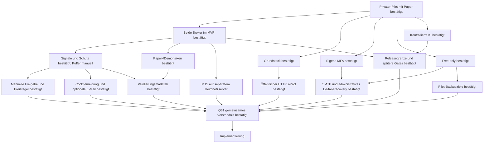

# Interview und Entscheidungsbaum

Skill: [grill-me](../SKILLS/grill-me/SKILL.md). Fragen werden in Runden entlang
bereits geklärter Voraussetzungen gestellt. „Ja“ akzeptiert die jeweils
genannte Empfehlung. Unbeantwortete Fragen bleiben offen.

Stand 2026-11-07: Runden 1–6 (Q1–Q30) beantwortet.
Q31 bestätigt das gemeinsame Verständnis und beauftragt den Umsetzungsstart.
Struktur und Planungsdokumente sind ausdrücklich beauftragt; Implementierung
des Entwurfs beginnt erst nach den erforderlichen Entscheidungen.

## Bestätigte Entscheidungen — Runde 1

| Frage | Nutzerentscheidung | Konsequenz |
|---|---|---|
| Q1 Erster Meilenstein | Ja: Cockpit, reproduzierbare Backtests und Paper zuerst | Kein Echtgeld als MVP-Abnahme; spätere Livefreigabe |
| Q2 Nutzerkreis | Ja: erst privat starten | Privater Nutzerkreis per Einladung; Tenantmodell von Beginn an; öffentlicher HTTPS-Einstieg in Q20 gewählt |
| Q3 Risikogrenzen | Ja, unbedingt | Tages-/Gesamt-/Positions-/Hebellimits unabhängig von Strategie/AI |
| Q4 KI/Selbstlernen | Ja | Offlineverbesserung und geprüfte Promotion statt unkontrollierter Liveänderung |
| Q5 Betrieb/Kosten | Vorhandener Server, Free-Tools/-Accounts; nur TradingView Essentials bezahlt | Keine neuen bezahlten Dienste buchen; Gratisquoten/Rechte und Kapazität prüfen |

Die Serverfreigabe ist keine pauschale Freigabe für Produktionsdeployment,
Echtgeldorders, destruktive Änderungen oder weitere kostenpflichtige Accounts.

## Bestätigte Entscheidungen — Runde 2

| Frage | Nutzerentscheidung | Konsequenz |
|---|---|---|
| Q6 Brokerumfang | Beide gleichzeitig für den ersten Release planen | Bitget und MT5 im MVP; Varianten in Q9/Q10 bestätigt |
| Q7 Architektur/Stack | Ja zum vorgeschlagenen Stack | Modularer Monolith, getrennte Worker, Python/FastAPI, Next.js/TypeScript, PostgreSQL/Jobs |
| Q8 Identitygrenze | Ja zur eigenen MFA-Anmeldung | Website-SSO später; lokales Authelia in Q14 bestätigt |

## Bestätigte Entscheidungen — Runde 3

| Frage | Nutzerentscheidung | Konsequenz |
|---|---|---|
| Q9 Crypto-Startumfang | Ja: BTC/USDT und ETH/USDT, Spot ohne Hebel, H4 | H1/Derivate spätere eigene Varianten |
| Q10 MT5-Startstrategie | Ja: vorhandenes XAUUSD Trend/Pullback | H1-Regime/M15-Entry; Risk-/Kosten-/Kausalitätsprüfung vor Übernahme |
| Q11 Crypto-Vorlage | Ja: schriftlicher Projektprompt maßgeblich | Abweichende Bildregeln nicht übernehmen |
| Q12 Staffel/Preisbezug | Ja: Geldbeträge und vorgeschlagene Preisbezüge | Quote-Budget +25 %, Abstand letzter tatsächlicher Fill, −50 % erster Fill |
| Q13 Prozessmodell | Docker Compose von Beginn an | systemd-Vorschlag verworfen; keine Dockerinstallation erfolgt |
| Q14 Identityprovider | Ja: lokale MFA aus der angebotenen Variante | Authelia OIDC, Passwort + TOTP/WebAuthn, administrierte Privatnutzer |

Antworten über das Interview übernehmen; keine implizite Zustimmung aus
Zeitablauf oder aus einer Zustimmung zu anderen Fragen ableiten.

## Bestätigte Entscheidungen — Runde 4

Die Antworten bestätigen Paper-/Demowerte, keine Echtgeldlimits.
Abweichungen von Empfehlungen werden ausdrücklich übernommen.

| Frage | Nutzerentscheidung | Konsequenz |
|---|---|---|
| Q15 Crypto-Signale | Ja: RSI14/Wilder, abgeschlossene H4-Kerzen | Erster Kauf nach zwei `<30`-Kerzen; danach Rearm `>30` und eine `<30`-Kerze plus 5%-Preisbedingung; genau 30 kein Trigger |
| Q16 Puffereinstieg | Abweichung: ausschließlich gesonderter Notfall | Fünf reguläre Stufen; sechste Reserve nicht als normaler Nachkauf; Q23 konkretisiert manuellen Einstieg |
| Q17 Gewinnschutz | Ja: Supertrend ATR10/Wilder ×3 und vorgeschlagene Schutzregeln | Aktivierung ab +5 % verkaufbarem Kurs zum tatsächlichen Durchschnitt; Nettobreakeven-Untergrenze, monotones Trailing, keine Nachkäufe danach, kein zusätzlicher Flipexit |
| Q18 Crypto-Paperprofil | Ja einschließlich −55%-Notausstieg | 10.000 virtuelle USDT; je 500 Kaufprincipal +5 Kostenreserve; 6 % Tages-/8 % Startkapitalverlust; Tagesbasis Equity 00:00 UTC, Gesamtbasis Startkapital |
| Q19 MT5-Demoprofil | Ja: getrenntes Brokerdemo mit vorgeschlagenen Limits | 0,25 % modelliertes Ideenrisiko, höchstens eine Idee, 1 % Tages-/5 % Startkapitalverlust; Tageswechsel Europe/Prague; Lots abrunden |
| Q20 Pilotzugriff | Abweichung: öffentlicher zentraler HTTPS-Einstieg schon im Privatpilot | Privater Nutzerkreis, öffentlicher Proxy; interne DB/Worker; Entwicklungsvorschau am2026-11-07 separat freigegeben und aktiviert; vollständiger Pilotrollout weiter separat |
| Q21 MFA-Mailweg | Ja: vorhandener kostenloser SMTP-Zugang | TLS, Absenderrechte und Zustellung prüfen; noch keine externen Nachrichten |
| Q22 MFA-Recovery | Abweichung: andere Methode, z. B. E-Mail reicht | E-Mail als ausreichender Identitätsnachweis; administrativer Ablauf in Q24 bestätigt |

Q16 genehmigt **keine** bestimmte Notfallschwelle und keine automatische
RSI-Umgehung. Q22 genehmigt **keinen** beliebigen automatischen Reset oder
Adresswechsel. Die gewünschte E-Mail-Recovery ist schwächer als ein unabhängiger
Ersatzfaktor: Ein kompromittiertes Postfach könnte einen Reset ermöglichen.
Authelia bietet bei strenger Faktoränderungspolicy keinen fertigen
Mail-only-Selbstservice; Quellen und vorgeschlagener Ablauf stehen in
[deployment-plan.md](deployment-plan.md).

## Bestätigte Entscheidungen — Runde 5

Q23 ersetzt die automatische Notfallregel durch eine manuelle Reserve.
Q25 ergänzt eine Nutzerangabe zur tatsächlichen Topologie.

| Frage | Nutzerentscheidung | Konsequenz |
|---|---|---|
| Q23 Gesonderter Puffer | Abweichung: für manuellen Einstieg behalten und Nutzer informieren | Keine automatische −40%-Schwelle/Order; konkrete Freigabe-/Preisregeln Q29, Meldekanal Q30 |
| Q24 E-Mail-Recoveryablauf | Ja: administrativer Reset nach E-Mail-Bestätigung | Kurz gültige Einmalchallenge an bestehende Adresse, kein gleichzeitiger Adresswechsel, Sitzungen/Token entziehen und neue MFA; normale Faktoränderung bleibt MFA-geschützt |
| Q25 MT5-Terminalbetrieb | MT5 läuft auf einem anderen Server im Heimnetz und soll mit diesem System kommunizieren | Ausgehende authentifizierte HTTPS-Bridge zum zentralen Einstieg; keine eingehenden Heimnetzports; Demo-/Kontobindung und konkreter Hoststand vor Einrichtung prüfen |
| Q26 Validierungsmaßstab | Ja: vorgeschlagener Forschungsmaßstab | Ziel ≥3 Jahre Crypto/≥2 Jahre brokerpassendes Gold; getrennte chronologische Fenster; im unabhängigen Holdout positiver Nettoertrag, PF ≥1,2, ≥30 geschlossene Baskets je Crypto-Asset bzw. ≥100 Goldtrades |
| Q27 Pilot-Sicherungsziele | Ja: Backup wie vorgeschlagen einplanen | RPO 24 Stunden/RTO 4 Stunden; tägliche verschlüsselte externe Sicherung, zusätzliche geschützte Offlinekopie und getrennte Schlüssel; konkretes Ziel/Restore vor Pilotfreigabe prüfen |
| Q28 Releasegrenze und spätere Gates | Ja: ersten Release so abgrenzen und danach ausbauen | M1 Cockpit/MFA/Tenants/Portfolio/Journal/Backtests/beide Paper-/Demopfade; echte KI und vollständige News-/Kalenderfeeds danach; Echtgeld/FTMO/AI-Provider/Kundenbetrieb ausdrücklich später entscheiden |

Die vorgeschlagene automatische −40%-Regel ist verworfen, auch als
automatisch übernommene Alarmgrenze. Manuelle Käufe dürfen unabhängige
Kontolimits und den bestehenden Schutz nicht umgehen.
Q26 trennt technische Paperbeobachtung von wirtschaftlicher Eignung; zu wenig
Historie/Trades ist kein bestandenes Ergebnis. Trainings-/Validierungszahlen
ersetzen die Mindeststichprobe im unabhängigen Holdout nicht. Diese Schwellen
sind ein bestätigter Forschungsfilter, kein statistischer Gewinnbeweis.
Der Referenzbacktest verwendet fünf reguläre Stufen mit ungenutztem Puffer;
rückblickend ausgewählte manuelle Käufe sind kein deterministischer Edge.
Tatsächliche Historienlänge, Terminalbetriebssystem/-build und genaue
Demo-Instanz sind weiterhin zu prüfen. „Server im Heimnetz“ ist eine
Nutzerangabe, kein durch uns geprüfter Remotehost.

## Bestätigte Entscheidungen — Runde 6

Q29/Q30 bestätigen die konkrete manuelle Reserve und die gewünschte Information.

| Frage | Nutzerentscheidung | Konsequenz |
|---|---|---|
| Q29 Manueller Puffer | Ja: vorgeschlagene manuelle Pufferregeln | Nach fünf regulären Stufen maximal eine bewusst bestätigte Stufe innerhalb ursprünglicher Reserve; ohne RSI, aber ≤95 % letzter regulärer Fill; Vorschau/MFA, unabhängige Risk-/Exit-/Schutzgates |
| Q30 Nutzerinformation | Ja: Cockpitmeldung plus optionale E-Mail | Einmal nach fünfter Stufe, E-Mail vom Nutzer einschaltbar; keine Order und keine ungefragte −40%-Alarmgrenze |

Im 500-USDT-Kaufprincipal sind etwa 135,53 USDT Puffer enthalten;
die 5-USDT-Kostenreserve gilt für den ganzen Basket. Ein manueller Einstieg
ersetzt weder das Budgetlimit noch die spätere Echtgeldfreigabe.

## Abschlussbestätigung

Die sachliche Frontier für M1 ist leer. Spätere Produkt-/Liveentscheidungen
sind durch Q28 ausdrücklich an ihre Gates verschoben. Technische Fakten
und Laufzeitnachweise erledigen wir bei Umsetzung und vor Pilotfreigabe.

Der konkrete Gesamtstand steht in [implementation-brief.md](implementation-brief.md).
Q31 ist bestätigt: gemeinsames Verständnis und Übergang
zur lokalen M1-Implementierung. Kein öffentlicher
Rollout und keine Echtgeldfreigabe.

## Ergänzung nach Q31: eigenes Bitget-Konto

2026-11-07: Nutzer nennt ein eigenes finanziertes Bitget-Konto mit Spot-
und Futureskapital. Jeder Plattformnutzer soll einen eigenen API-Key in
seinem Bitget-Konto erstellen und damit seine Verbindung einrichten.
Die Folgefrage ist beantwortet: **Classic mit getrennten Wallets**.
Der erste private Konto-Adapter verwendet daher Classic V2.

Dies ergänzt Kontoeinrichtung und Portfolioquellen. BTC/ETH Spot-H4,
Paper vor Echtgeld und spätere Futures-/Livegates bleiben maßgeblich.
Umsetzung und Schutzgrenzen: [bitget-connection.md](bitget-connection.md).

## Entscheidungsbaum

Weitere Bestätigung2026-11-07: **zusätzliche kostenlose Passkey-Bestätigung
direkt im Cockpit für Kontoänderungen, mit einmaliger Nutzerregistrierung.**
Die Frage entstand aus dem nachgewiesenen Authelia-Faktorfrischebefund.
Authelia bleibt Loginprovider. Implementierung und Gates:
[passkey-step-up.md](passkey-step-up.md).

## Folgefragen nach Voraussetzung

### Q32: Paper-Tagesbasis

2026-11-09, **bestätigt: Nutzer folgt der Empfehlung und betont RSI für Einstiege**.
Q18 hält Equity00:00UTC
als Tagesbasis und6% als Crypto-Tageslimit fest. REST-Polling liefert den
exakten Mitternachts-Bid nicht zuverlässig; ohne Tagesbasis bleiben Käufe gesperrt.

Freigegebene Regel: Für offene Paperpositionen den um00:00UTC
geschlossenen H4-Kurs ausschließlich als gekennzeichnete Modellbewertung der
Tagesbasis verwenden. Zeitpunkt und6%-Limit bleiben erhalten; tatsächliche
Paperfills nutzen weiter echte Bid/Ask-Quotes. Fehlende Grenzkerzen sperren
Käufe. Die erforderliche ausdrückliche Entscheidung nach AGENTS.md liegt vor.
RSI14/Wilder auf geschlossenen H4-Kerzen bleibt für automatische Einstiege
erforderlich; die Bewertungsregel erzeugt kein Signal. Die zuvor bestätigte
manuelle sechste Tranche Q29 behält ihre eigenen Vorschau-/Bestätigungsregeln.

### Q33: Gemeinsames Basketportfolio und spätere KI-Prüfung

2026-11-09, **Planungsziel bestätigt**:3–5 Coins gleichzeitig in Baskets,
das Kontokapital vollständig dafür einplanen. Später soll eine KI RSI-
Einstiegssignale anhand Marktphase/Wall Street Cheat Sheet, Fear & Greed,
News und Crypto-Vierjahreszyklus bewerten. Hebel und weniger Einstiegsstufen
im Aufwärtstrend sind mögliche spätere Varianten.

Auf die konkrete Rückfrage zu größeren Baskets bestätigt der Nutzer:
**„6 % / 8 % beibehalten (empfohlen)“**. Kontolimits bleiben bindend und
können Käufe sperren/Positionen schließen, bevor eine Staffel vollständig ist.
Kapitalzuordnung ist keine Freigabe für vollständige Exposition.
Zusätzliche Coins, genaue Kaufbudgets, Variante/AI-Autorität, Derivate-
/Marginprofil und Betriebsaktivierung sind nicht damit beschlossen.
[Konkreter Plan und korrelierte Stressrechnung](multi-basket-ai-plan.md).

Mit Q28 liegen Echtgeld-/FTMO-/AI-Provider- und
Kundenentscheidungen ausdrücklich an späteren Gates. Der Interviewabschluss
ist in Q31 bestätigt.

### Q34: Größeres Offline-Forschungsprofil und Nachkaufstaffel

2026-11-10, **bestätigt**: Nutzer antwortet „danke das passt so“ auf die
konkrete Empfehlung gleicher3–5 Slots,1% Principal-Kostenreserve und
zusätzlicher Kaufprüfung bei gemeinsamem−50%-Stress;6%/8% bleiben bindend.
Er erinnert ausdrücklich daran, nach weiterem Kursfall nach der bisherigen
Strategie nachzukaufen und den durchschnittlichen Einstand zu senken.
RSI-Rearm,5%-Abstand zum letzten tatsächlichen Einstieg,25% Volumenzuwachs,
fünf reguläre Stufen und manuelle sechste Reserve bleiben erhalten.
Freigabe gilt für Offlineforschung, nicht Marktassets/Live-/Betriebsaktivierung.
Zykluswiederbelegung und zusätzliche Coins wurden anschließend in Q35 bestätigt.
[Nachkaufadapter](staged-portfolio-research.md).

### Q35: Kandidatenpool und feste Slotwiederbelegung

2026-11-10, **bestätigt**: Nutzer ergänzt die vorgeschlagenen BTC/ETH/SOL/BNB/XRP
um ZEC/HYPE/XMR/LINK/XLM/NEAR/BCH/LTC/UNI. Einstiegssignale entstehen zeitversetzt;
der Pool umfasst14 Kandidaten, weiterhin höchstens3–5 gleichzeitige Baskets.
Auf die feste Wiederbelegung nach vollständigem normalem abgeglichenem
Gewinn-/Trailingexit antwortet er „Ja klar“. Gleiches nominales Slotbudget,
neues RSI-Signal und sämtliche Risiko-/Kosten-/Abgleichgates; kein automatisches
Wachstum aus Gewinnen, kein automatischer Neustart nach Riskstop.
Verfügbarkeit/Historiendaten sind separat nachzuweisen; kein Wechsel zu
Futures/Hebel oder Livefreigabe. [Umsetzung](candidate-pool-research.md).

### Q36: Realisierte Gewinne begrenzt in Etappen einbeziehen

2026-11-10: Nutzer ändert die bisherige rein fixe Planung. Realisierte Gewinne
geschlossener Baskets sollen gesammelt werden; sobald sie eine vollständige
Basketstaffel finanzieren, sind zusätzliche Slots oder höhere zukünftige
Basketbudgets gewünscht. Drei gewinnbringende Abschlüsse sind ein Beispiel.
Zunächst erfragte Empfehlung:
nach drei abgeglichenen Abschlüssen prüfen, Nettoüberschuss nach Kosten und
Verlusten, ursprüngliches Vollbudget inklusive manueller/Kostenreserve als
Schwelle; zuerst zusätzliche Slots, danach künftige Budgets erhöhen.
Offene Budgets einfrieren, bestehende Risiko-/Signal-/MFA-Gates erhalten.
**Bestätigte Antwort:** „Ja option1...erst zusätzliche slots dann Volumen
erhöhen ... max7 gleichzeitige Baskets ... Ab7 steigern wir das Volumen.“
Damit zusätzliche Slots bis sieben, danach höhere Budgets neuer Baskets;
mindestens drei weitere abgeglichene Abschlüsse und eine ursprüngliche
volle Basketstaffel je Etappe. Nettoverluste/Kosten und bereits zugeordnetes
Gewinnkapital einrechnen. Keine neue Risikobasis oder Livefreigabe.
IP-061 implementiert das separate Offlineprofil.
[Vertrag und Beispiel](profit-etapes.md).

### Q37: Späteres Futuresziel und Alternativkandidaten

2026-11-10, **bestätigt**: AVAX/HBAR/TRX/BGB/BAT/RENDER sind mögliche
Alternativen zu XMR/ZEC/HYPE/XLM. Nutzer plant später Futures statt Spot,
Hebel2×–10× bei starken Uptrends. Anschließend explizit bestätigt:
isolierte USDT-M-Long-Baskets, Budget als echtes Kapital einschließlich
Kosten/Marginpuffer, keine automatischen Nachschüsse aus anderen Baskets;
−50%-Stress sowie6%/8% bleiben verbindlich. Hebel nötigenfalls reduzieren
oder Einstieg sperren, keine alternative kleinere Rückgangstoleranz gewählt.

IP-062 prüft öffentlich20 aktuelle Kontrakte und frühe Trade-/Markproben.
Exakte Regime-/Hebelauswahl, Budgetaufteilung und offene-Basket-Verhalten
beim Regimewechsel noch zu spezifizieren; keine rückblickende Uptrendgewissheit.
IP-063: eigene Futuresökonomie vor Leistungs-/Paperlauf. Keine endgültige
Ersatzkohorte, Konto-/Hebeländerung oder Echtgeldfreigabe aus diesen Antworten.
[Vertrag und Belege](futures-research.md).

### Q38: Zusätzlicher separater Binance-Futuresvergleich

2026-11-11, **bestätigt** mit „Ja können wir gern machen“: dreijährigen
zusätzlichen Futuresvergleich mit frei verfügbaren eigenen Binance-Kurs- und
Fundingdaten vorbereiten. Ergebnisse als Binanceforschung kennzeichnen;
Bitget bleibt geplantes Handelsziel. Kein Binancekonto/private Keys nötig,
keine Binancefunding-Beimischung in angeblich native Bitgetperformance,
keine Konto-/Echtgeld-/Livefreigabe. IP-070 belegt die Datenbasis; wirtschaftliches
Protokoll und Nettoleistungslauf folgen IP-069.
[Datenvertrag und Abnahme](binance-futures-research-data.md).

Q39,2026-11-11: Nutzer beauftragt ausdrücklich H1-Forschung und einen
H4-Vergleich mit dem bestätigten größeren Basket-Kapitalprofil. IP-072:
gleiche Binance-Spot-Daten,10.000 USDT, drei/fünf feste Slots und unveränderte
Nachkauf-/Risikoregeln. Keine automatische Paper-/Live-Zeitrahmenumstellung
oder vorweggenommene Futuresrendite.
[Vergleich](h1-h4-basket-comparison.md).

### Q40: Futures priorisieren und H4-Einstiege mit H1-Schutz vergleichen

2026-11-11: Nutzer bestätigt die Bedeutung des beobachteten SOL-Notausstiegs
und schlägt H4-Einstiege mit nachgezogenem H1-Supertrend vor.
Die Basketstrategie soll als Futuresstrategie untersucht werden; eine andere
Spot-Investingstrategie folgt später separat. Bestehende Spotläufe bleiben
historische Referenzen, keine Umbenennung in Futuresperformance.
Die Nachfrage nach6%/8% widerruft die bestätigten Kontolimits nicht.

Forschungsvariante: geschlossene H4-RSI-Signale und bestätigte Nachkäufe,
geschlossener H1-Supertrend ATR10/Wilder×3 für den Schutz.
Bestehende+5%-Aktivierung, Netto-Breakeven-Untergrenze, nur aufwärts
nachgezogener Stop/Kaufstopp, manuelle sechste Stufe und−55%/−50%/6%/8%
bleiben erhalten. Keine rückblickende Verwendung unfertiger H1-Kerzen.
Dies ist ein Forschungsauftrag, keine automatische Runtime-/Liveumstellung.

Für einen kontrollierten Futuresvergleich H4- und H1-Supertrend auf derselben
feineren Ausführungszeitachse auswerten; feinere Preisbeobachtung und anderer
Indikatorzeitrahmen sind getrennte Änderungen. Funding/Kosten/isolierte Margin
und Liquidationspuffer gehören zur Nettoauswertung. Passende native
Futures-H1-Daten und wirtschaftliches Protokoll bleiben vor Leistung nötig;
Spot-H1 oder synthetische weitere Coins ersetzen diese nicht.
IP-069 ist hierfür priorisiert; bestehende Bitget-Handelszielentscheidung
und Holdoutschutz bleiben erhalten.

### Q41: Vollständige Kaufstaffel statt begrenzendem Kontostressprofil

2026-11-12: Nutzer bestätigt die Tabelle für10000 USDT/drei Baskets:
je3333,33 Gesamtbudget,3300,33 Sechsstufenpool und33,00 Kostenreserve;
fünf reguläre Beträge293,13/366,42/458,02/572,53/715,66 und manuelle
Reserve894,57, gerundete Darstellung der bereits implementierten Gewichte.
Kontoschutzgrenzen dürfen die geplanten Nachkäufe nicht verhindern.
Dies ändert die frühere Q37/Q40-Vorgabe verbindlicher6%/8%-Kontolimits
für die nächste Futures-Forschungsvariante.

Umsetzung der Richtung:6%/8% als Warnschwellen, gemeinsamer−50%-Kontostress
als Diagnose statt sperrende Kaufprüfung. Keine ungekennzeichnete Änderung
alter eingefrorener Ergebnisse oder laufender Paperprofile.
Budgetdeckung, tatsächliche Margin/Liquidation, vollständige Signale,
−55%-Notausstieg, Schutzaktivierung/Nettofloor und die ausschließlich
manuelle sechste Stufe bleiben gesonderte Bedingungen. Vollständige Planung
erzwingt keine Käufe ohne RSI/Rearm/5%-Abstand oder manuelle Freigabe.
Der spätere AI-Filter ist kein Beleg garantierter Erholung/Profitabschlüsse
oder rechtzeitiger Liquidationsdeckung. Rückkehr zum Netto-Breakeven und
belegbare Margin bis zum Ausstieg sind auch bei langsamem Rückgang offen.

**Damals gefragt, durch Q42 beantwortet:** Sind die Tabellenbeträge eigenes Einstiegskapital
(Nominal bei2× doppelt) oder bereits Positionsnominal (Margin entsprechend
kleiner)? Die Antwort ist vor einem konkreten Futures-Marginprofil nötig.
Eine automatische Puffergröße oder2×–10×-Profitrechnung wird nicht erfunden.

### Q42: Eigenkapital je Einstieg und akzeptierte Liquidationen

2026-11-12, bestätigt:293,13 USDT sind Eigenkapital für den ersten Einstieg;
Hebel bestimmt daraus Kaufnominal. Später wählt ein AI-Agent den Hebel nach
Marktphase innerhalb des bisherigen2×–10×-Rahmens. Nutzer akzeptiert bei
höherem Hebel ausdrücklich Liquidationen vor Abschluss der fünf Käufe.
Damit ist die frühere−50%-Überlebensgarantie jedes einzelnen Fillstands
für das neue Forschungsprofil aufgehoben; tatsächliche Initialmargin,
Budgetdeckung und Liquidationen werden weiterhin korrekt berücksichtigt.
Keine automatische Umwidmung unbenutzter Nachkäufe zu zusätzlicher Margin
oder Finanzierung aus anderen Baskets. Bisherige manuelle Stufe6 bleibt.
AI- oder garantierte Erholung nicht als bereits validierte Wirkung ausgeben.

Damals gefragt, durch Q43 beantwortet: Hebel je Basket beim Start einfrieren oder je Nachkauf neu
bewerten? Empfehlung für erstes Profil: je Basket festhalten; keine
automatische Hebelsteigerung nach Stufennummer. Historische Daten/Regime
müssen zum jeweiligen Zeitpunkt bekannt gewesen sein.
[Kapitalrechnung, Modellbeispiel und Forschungsregeln](futures-capital-ladder.md).

### Q43: AI-Hebel vor erstem Kauf für kompletten Basket einfrieren

2026-11-12, ausdrücklich bestätigt: Das spätere AI-Profil bewertet Marktphase
und Risiko vor dem ersten Kauf und legt den Hebel für den gesamten Basket fest.
Alle folgenden regulären Käufe und eine bestätigte manuelle sechste Stufe
verwenden denselben Hebel. Keine Erhöhung nach Stufennummer und keine
Hebelanpassung eines offenen Baskets bei einem späteren Regimewechsel.
Ein neuer Basket erhält eine neue Bewertung. Hebelrahmen2×–10× aus Q37/Q42.
Exakte Kriterien/Modellfreigabe und kausale historische Marktphasenprüfung
bleiben ausstehend; bislang keine aktive AI oder validierte AI-Rendite.
Isolierte Margin, Budget-/Orderwahrheit und Q41/Q42-Risikoprofil erhalten.

### Q44: Kostenreserve am vollständig profitablen Abschluss

2026-11-12, **bestätigt**. IP-080 H1-RSI-Test:
BTC-Zyklus4 schließt mit446,84 USDT Nettogewinn. Gebühren/Funding22,10 USDT
übersteigen19,80 USDT Kostenreserve um2,30 USDT und sperren dadurch das
gesamte Konto ab2023-01-16. Voller Replay-/Kostenbeleg:
[H1-Ergebnisse](futures-h1-entry-results-20261112.md).

Gefragt für einen separaten Forschungsvergleich: Darf ausschließlich beim
vollständig geschlossenen profitablen Basket der eigene realisierte Gewinn
die Kostenreserveüberschreitung decken, ohne globale Kontosperre?
Empfehlung: ja, alle Kosten weiter netto verbuchen; offene Kosten-/Margin-/
Liquidationsgrenzen, tatsächliche Kaufstaffel und manuelle Reserve erhalten.
Keine Finanzierung aus anderen Baskets oder noch unrealisierten Gewinnen.
Nutzerantwort: **„Ja, nur aus dem eigenen abgeschlossenen Basketgewinn
(empfohlen)“**. Neue separate Policy erlaubt nur vollständige normale
Abschlüsse mit positivem Netto nach allen Kosten, das mindestens den gesamten
Kostenüberhang deckt. Keine zusätzliche Cashgutschrift oder doppelte
Gewinnbuchung; alte Halts werden nicht gelöscht. Q41 bindet alle übrigen
Budgets weiter. Bestehende eingefrorene Profile bleiben historisch.

Konkrete Umsetzungsfakten recherchieren wir: unterstützte Versionen exakt pinnen,
Historienlänge/-qualität prüfen, Brokerkosten/Metadaten und Hostlast messen.
Vor Pilotrollout müssen Domain/TLS, SMTP/Empfänger, Terminalbindung,
externes Backupziel/Schlüssel und Recoverytests konkret geprüft sein. Eine
Planentscheidung veröffentlicht keine Dienste und versendet keine Nachrichten.

Umweltfakten recherchieren die Agents selbst. Entscheidungen und Risikotoleranz
gehören dem Nutzer. Offene Fakten dürfen abhängige Fragen verzögern, aber
unabhängige Planung nicht blockieren.
