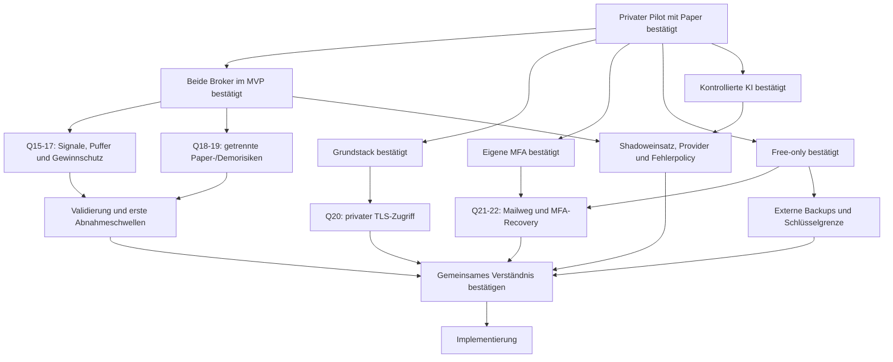

# Interview und Entscheidungsbaum

Skill: [grill-me](../SKILLS/grill-me/SKILL.md). Fragen werden in Runden entlang
bereits geklärter Voraussetzungen gestellt. „Ja“ akzeptiert die jeweils
genannte Empfehlung. Unbeantwortete Fragen bleiben offen.

Stand 2026-11-07: Runden 1–3 beantwortet; Runde 4 (Q15–Q22) gestellt.
Eine Abschlussbestätigung des gemeinsamen Verständnisses steht noch aus.
Struktur und Planungsdokumente sind ausdrücklich beauftragt; Implementierung
des Entwurfs beginnt erst nach den erforderlichen Entscheidungen.

## Bestätigte Entscheidungen — Runde 1

| Frage | Nutzerentscheidung | Konsequenz |
|---|---|---|
| Q1 Erster Meilenstein | Ja: Cockpit, reproduzierbare Backtests und Paper zuerst | Kein Echtgeld als MVP-Abnahme; spätere Livefreigabe |
| Q2 Nutzerkreis | Ja: erst privat starten | Einladung/privater Zugriff; Tenantmodell von Beginn an |
| Q3 Risikogrenzen | Ja, unbedingt | Tages-/Gesamt-/Positions-/Hebellimits unabhängig von Strategie/AI |
| Q4 KI/Selbstlernen | Ja | Offlineverbesserung und geprüfte Promotion statt unkontrollierter Liveänderung |
| Q5 Betrieb/Kosten | Vorhandener Server, Free-Tools/-Accounts; nur TradingView Essentials bezahlt | Keine neuen bezahlten Dienste buchen; Gratisquoten/Rechte und Kapazität prüfen |

Die Serverfreigabe ist keine pauschale Freigabe für Produktionsdeployment,
Echtgeldorders, destruktive Änderungen oder weitere kostenpflichtige Accounts.

## Bestätigte Entscheidungen — Runde 2

| Frage | Nutzerentscheidung | Konsequenz |
|---|---|---|
| Q6 Brokerumfang | Beide gleichzeitig für den ersten Release planen | Bitget und MT5 im MVP; Varianten in Q9/Q10 bestätigt |
| Q7 Architektur/Stack | Ja zum vorgeschlagenen Stack | Modularer Monolith, getrennte Worker, Python/FastAPI, Next.js/TypeScript, PostgreSQL/Jobs |
| Q8 Identitygrenze | Ja zur eigenen MFA-Anmeldung | Website-SSO später; lokales Authelia in Q14 bestätigt |

## Bestätigte Entscheidungen — Runde 3

| Frage | Nutzerentscheidung | Konsequenz |
|---|---|---|
| Q9 Crypto-Startumfang | Ja: BTC/USDT und ETH/USDT, Spot ohne Hebel, H4 | H1/Derivate spätere eigene Varianten |
| Q10 MT5-Startstrategie | Ja: vorhandenes XAUUSD Trend/Pullback | H1-Regime/M15-Entry; Risk-/Kosten-/Kausalitätsprüfung vor Übernahme |
| Q11 Crypto-Vorlage | Ja: schriftlicher Projektprompt maßgeblich | Abweichende Bildregeln nicht übernehmen |
| Q12 Staffel/Preisbezug | Ja: Geldbeträge und vorgeschlagene Preisbezüge | Quote-Budget +25 %, Abstand letzter tatsächlicher Fill, −50 % erster Fill |
| Q13 Prozessmodell | Docker Compose von Beginn an | systemd-Vorschlag verworfen; keine Dockerinstallation erfolgt |
| Q14 Identityprovider | Ja: lokale MFA aus der angebotenen Variante | Authelia OIDC, Passwort + TOTP/WebAuthn, administrierte Privatnutzer |

Antworten über das Interview übernehmen; keine implizite Zustimmung aus
Zeitablauf oder aus einer Zustimmung zu anderen Fragen ableiten.

## Aktuelle Frontier — Runde 4

Die aktuelle Runde enthält diese noch offenen Empfehlungen. Zahlen sind
**keine** genehmigten Echtgeld-/Demolimits.

| Frage | Konkrete Empfehlung | Status |
|---|---|---|
| Q15 Crypto-Signale | RSI14/Wilder, H4-Schlusswerte; zwei Kerzen erster Kauf; Rearm über 30, eine Kerze Nachkauf unter 30 plus Preisbedingung | Offen |
| Q16 Puffereinstieg | Gleiche Signal-/Preisbedingungen wie reguläre Nachkäufe, keine RSI-Umgehung | Offen |
| Q17 Gewinnschutz | Supertrend ATR10/Wilder ×3; ab +5 % verkaufbarem Kurs, Nettoeinstand-Untergrenze, monotones Trailing, keine Nachkäufe danach | Offen |
| Q18 Crypto-Paperprofil | 10.000 virtuelle USDT; je 500 Kaufbudget +5 Kostenreserve; 6 % Tages-/8 % Startkapitalverlust, −55 % Preisnotausstieg | Offen |
| Q19 MT5-Demoprofil | Getrenntes Brokerdemo; 0,25 % Handelsideenrisiko, eine Idee, 1 % Tages-/5 % Startkapitalverlust | Offen |
| Q20 Privater Zugriff | Entwicklung über Tunnel/privates Netz mit stabilen TLS-Domainnamen; öffentlicher Einstieg später | Offen |
| Q21 MFA-Mailweg | Vorhandener kostenfreier SMTP mit TLS, zunächst nur planen/prüfen | Offen |
| Q22 MFA-Recovery | Unabhängiger Ersatzfaktor, kein Mail-only-Wechsel, administrativer Identitätsnachweis | Offen |

Q16 entscheidet die Wiederverwendung der normalen Nachkaufbedingungen unabhängig
von der genauen Q15-Bestätigungskerzenzahl. Q17 betrifft den getrennten Schutzpfad.
Q18 ist ein expliziter Paper-Vorschlag, keine stillschweigende Strategieänderung.

## Entscheidungsbaum

## Folgefragen nach Voraussetzung

Nach der aktuellen Runde bleiben diese abhängigen Punkte:

- Nach Q15–Q19: Warm-up-/Kosten-/Fillmodell, konkrete Broker-/Kontoprofile,
  Testhistorien und vor Optimierung festgelegte Abnahmeschwellen.
- Nach Q19: FTMO-Phase falls relevant,
  Terminalhosting, lokaler Betrieb und Datenhistorie.
- Nach Markt-/Kontotyp: erste Paperkapitalbasis und konkrete Risikolimits.
  Echtgeldbetrag/Livekriterien können nur ausdrücklich an ein späteres Gate
  delegiert werden, niemals stillschweigend angenommen.
- Nach Betriebswahl: gepinnte Laufzeiten, Hostressourcen und
  Priorisierung von Entwicklung/Research/Live.
- Nach Q20–Q22: konkrete Zugangs-/Mail-/Recoverytests; keine externen Nachrichten
  oder Host-/DNSänderungen ohne den notwendigen konkreten Auftrag.
- Nach Betriebswahl: tolerierbare Ausfälle, kostenlose externe Sicherung,
  Schlüsselwiederherstellung und Alarmierungswege.
- Nach erstem Strategiepfad: AI zunächst deaktiviert/Shadow/Veto,
  erlaubte Daten, kostenloser Provider und Timeoutpolicy.
- Nach formaler Strategie: Mindestdatenmenge, Kostenmodell,
  Benchmark und Abnahmekriterien vor Optimierung.

Umweltfakten recherchieren die Agents selbst. Entscheidungen und Risikotoleranz
gehören dem Nutzer. Offene Fakten dürfen abhängige Fragen verzögern, aber
unabhängige Planung nicht blockieren.
