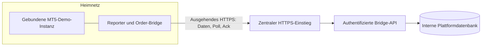

# MT5-Bridge zum Heimnetzserver

Stand 2026-11-07. Q25: MT5 läuft laut Nutzer auf einem separaten Server im
Heimnetz und soll mit der neuen Plattform kommunizieren. Dies ist der
Planungsstand, keine eingerichtete Verbindung oder Remoteprüfung.
Q19 bestätigt ein getrenntes Brokerdemo; bestehende Handelssysteme nicht ändern.

## Verbindung und Kontobindung

Commands kommen als Antworten auf ausgehende Pollrequests zurück.
Keine eingehenden Heimnetzports, Routerweiterleitungen oder öffentlich
erreichbare MT5-API. Ausschließlich TLS mit geprüften Zertifikaten; kein
HTTP-Fallback oder abgeschaltete Validierung.

Eigene widerrufbare Geräteidentität, serverseitig an Tenant, Konto und
Broker-Server gebunden. Bridge-Endpunkte verwenden Maschinenauthentifizierung
und Replayprüfung statt interaktiver Browser-MFA. Der Proxy darf dafür keinen
ungeschützten Pfad schaffen. Credentials lokal mit passenden Dateirechten;
keine Tokens in URLs, Git, Charts oder Logs.

Für Demo eine ausschließlich diesem Profil zugeordnete Terminalinstanz
vorsehen. Konkrete Instanz-/Hosteinrichtung vor Ausführung prüfen.
Beim Start und unmittelbar vor jeder Order die erwarteten
`ACCOUNT_SERVER`, `ACCOUNT_LOGIN` und `ACCOUNT_TRADE_MODE_DEMO` prüfen.
Bei Abweichung sperren, nicht automatisch Konten wechseln.
Ein aktiver Writer pro tatsächlichem Brokerkonto, auch bei mehreren
Terminalinstanzen oder doppelt angelegten Plattformverbindungen.

## Daten, Commands und lokale Schutzgrenze

Reporter liefert Konto-/Equityzustand, Symbolregeln, abgeschlossene Bars,
Deals und Heartbeat mit Event-/Empfangszeit. Brokerzeit explizit nach UTC
überführen; H1-Regime darf M15-Signale erst nach H1-Schluss beeinflussen.
Historienlänge, Lücken, Bid/Ask und Kosten vor Forschungsfreigabe prüfen.

Commands enthalten eindeutige ID, gebundenen Payload, Konto, Strategie-/
Riskversion, Sequenz und Ablaufzeit. Server und EA prüfen Identität,
Kontobindung, Frist, Datenfrische und erlaubte Aktion.
Der EA erzwingt die freigegebenen lokalen Risikogrenzen ebenfalls.
Keine neue Exposition bei ungültiger Freigabe oder Kontomismatch;
Schutz-/Reconciliationaktionen getrennt behandeln.

Dauerhaftes lokales Commandjournal vor Orderdispatch und dokumentierte
Brokerkorrelation. `OrderSend(true)` ist kein Fill; Retcodes, Tradeevents,
Deals und Positionsabgleich entscheiden. Verlorenes Ack erzeugt keinen
zweiten Versand. Nach Neustart oder unklarer Antwort zuerst abgleichen.
Commandablauf oder Leaseentzug holen eine bereits abgeschickte Brokerorder
nicht zurück.

Bei Plattform-/Internetverlust bleibt bereits bestätigter brokerseitiger
Schutz erhalten. Neue Exposition stoppt nach Ablauf der gültigen Freigabe.
Der EA darf Schutzmaßnahmen nicht von einer erfolgreichen Cloudpoll-Antwort
abhängig machen. Serverausfall ist kein Nachweis, dass alle Positionen
geschlossen wurden.

## Polling und MT5-Besonderheiten

Native `WebRequest` ist synchron und benötigt eine zugelassene Ziel-URL.
Kurze begrenzte Requests, Timeouts, Backoff und Rate Limits vorsehen.
Ein laufender `OnTimer`-Handler verarbeitet keine beliebige Zahl verpasster
Timerereignisse; keine garantierte Sekundenfrequenz behaupten.
Reporting und kritischen Schutz nicht hinter lange Requests stellen.

`WebRequest` funktioniert nicht im MT5 Strategy Tester. Deterministischer
Strategiekern und simulierte Bridgeverträge werden lokal geprüft;
Netzwerk-/Terminalfälle zusätzlich in der gebundenen Demo-Instanz.
Native `WebRequest` dokumentiert keinen Clientzertifikatparameter:
mTLS nicht als unmittelbar verfügbare EA-Funktion zusagen.

## Einrichtung und Abnahme vor Pilotfreigabe

Zu inventarisieren: tatsächliches OS, Terminalbuild, verfügbare separate
Demo-Instanz, EA-/WebRequest-Fähigkeit, Symbolmetadaten und vollständige Historie.
Konkrete Zugänge über geschützte Einrichtung, keine Credentials in Dokumenten
oder Interviewantworten. Kein Remoteeingriff im Rahmen dieser Planung.

- Ausgehend HTTPS erfolgreich; keine neuen eingehenden Heimnetzports.
- Gerätewiderruf, falscher Tenant/Account/Brokerserver und Replay abgewiesen.
- Echtgeldkonto statt Demo erkannt und Ausführung gesperrt.
- Timeout, Ackverlust, Doppelzustellung und Neustart ohne Blind-Resend.
- Teilfills und externe/manuelle Brokertrades korrekt reconciliert.
- Tageswechsel Europe/Prague, Risiko/Lotrundung und Brokerstopgrenzen geprüft.
- Verbindungsverlust sperrt neue Exposition; vorhandener Schutz bleibt nachweisbar.
- Historienkausalität und Datenfrische; keine Zukunftsbars im H1/M15-Signal.

Offizielle Grundlagen: [sources.md](sources.md). Fachregeln:
[trading.md](trading.md). Ausführungstickets IP-016/IP-020:
[Ticketboard](tasks/board.md).
